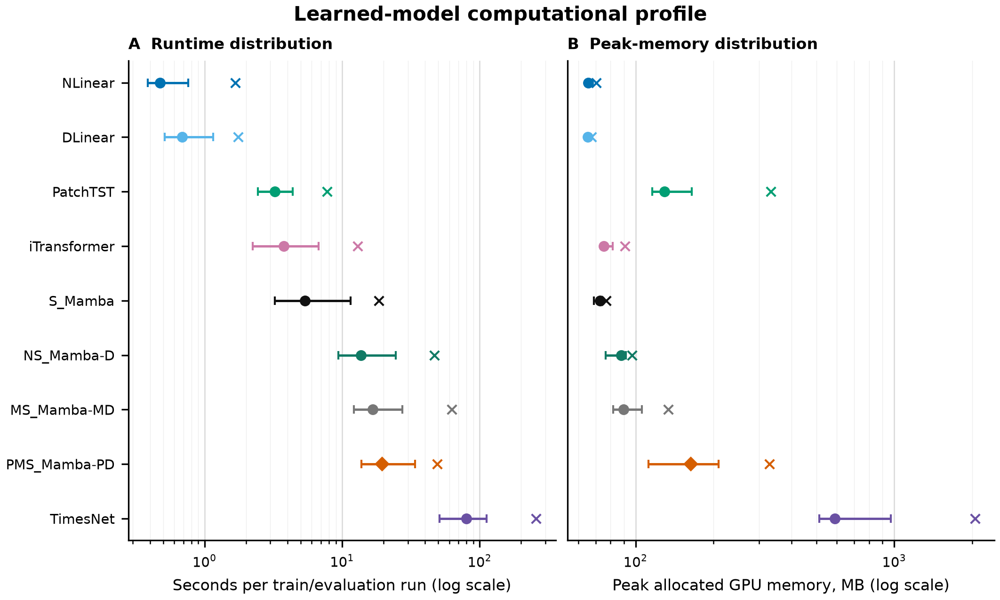
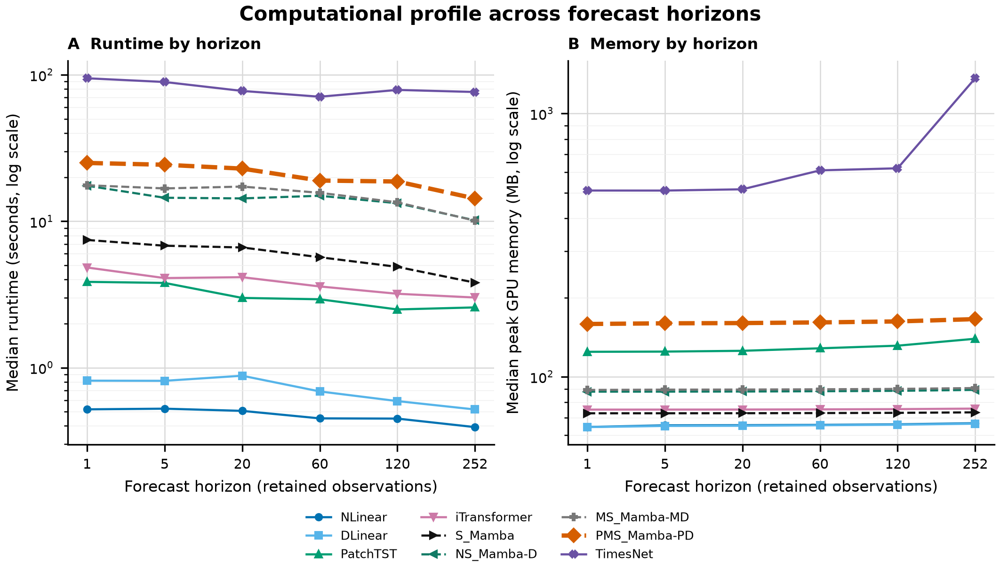
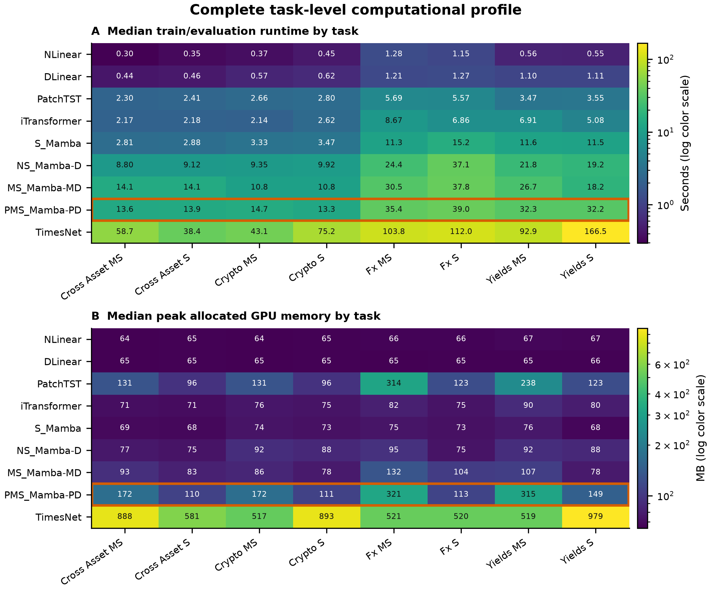

# Computational Profile

Updated: 2026-08-04

## Direct answer

The frozen V1 release contains computational profile data for all **2,160 learned-model
task-horizon-seed runs**. Each of the nine learned models has 240 runs: 8 tasks x 6
horizons x 5 seeds.

The profile supports a bounded efficiency claim for PMS-Mamba against TimesNet. It does
not support a claim that PMS-Mamba is faster than PatchTST or Transformers generally.
PMS-Mamba's median train/evaluation runtime is 19.57 seconds, compared with 3.24 seconds
for PatchTST, 3.77 seconds for iTransformer, and 79.82 seconds for TimesNet.

## What was measured?

For each completed run, timing begins immediately before experiment construction and
ends after model training and final test evaluation. The reported runtime therefore
includes model construction, data-loader use, training with early stopping, checkpoint
reload, prediction, and metric computation. It is not isolated inference latency.

GPU memory is `torch.cuda.max_memory_allocated()` after resetting CUDA peak-memory
statistics immediately before experiment construction. It measures peak memory
allocated by PyTorch tensors. It does not measure CUDA reserved memory, whole-process
RAM, total device occupancy, energy, or power.

The exact measurement implementation is in
[run_dataset_optuna.py](../scripts/optuna/run_dataset_optuna.py#L549). All models use
their independently validation-selected hyperparameters. Consequently, the profile is
an operational comparison of the executed benchmark configurations, not a
matched-parameter or matched-sequence-length complexity experiment.

## Runtime environment

| Field | Frozen value |
| --- | --- |
| GPU | NVIDIA GeForce RTX 5090 D |
| PyTorch | 2.8.0+cu128 |
| CUDA runtime reported by PyTorch | 12.8 |
| cuDNN | 91002 |
| `mamba-ssm` | 2.3.1 |
| Deterministic algorithms | Enabled |
| Learned-model profile rows | 2,160 |
| Total recorded runtime | 41,132.44 s = 11.43 h |

These values come from the frozen
[runtime environment](../reproducibility/nonstationary_analysis_v1/final/runtime_environment.json).

## Complete model-level profile

Each median and interquartile range below is computed from 240 runs. Runtime share is
the model's share of the 11.43 summed recorded GPU-hours. `CV` is the median
coefficient of variation of path RMSSE across the five final seeds; it measures result
stability rather than computational variation.

| Model | Runs | Total min | Runtime share | Runtime median [IQR], s | Runtime max, s | Peak memory median [IQR], MB | Peak memory max, MB | Seed CV |
| --- | ---: | ---: | ---: | ---: | ---: | ---: | ---: | ---: |
| NLinear | 240 | 2.54 | 0.37% | 0.48 [0.39-0.76] | 1.67 | 65.6 [64.8-66.7] | 70.3 | 1.12% |
| DLinear | 240 | 3.27 | 0.48% | 0.68 [0.51-1.15] | 1.75 | 65.3 [64.7-65.7] | 67.4 | 5.42% |
| PatchTST | 240 | 14.36 | 2.09% | 3.24 [2.44-4.37] | 7.76 | 129.4 [115.8-164.9] | 333.5 | 4.48% |
| iTransformer | 240 | 19.47 | 2.84% | 3.77 [2.24-6.76] | 12.93 | 75.3 [73.9-81.4] | 90.8 | 2.38% |
| S-Mamba | 240 | 30.34 | 4.43% | 5.38 [3.23-11.50] | 18.48 | 72.8 [68.9-74.4] | 77.0 | 0.44% |
| NS-Mamba | 240 | 73.23 | 10.68% | 13.68 [9.35-24.55] | 46.72 | 88.0 [76.4-91.8] | 96.7 | 0.55% |
| MS-Mamba | 240 | 85.96 | 12.54% | 16.67 [12.12-27.34] | 62.48 | 89.8 [81.8-105.8] | 133.7 | 0.81% |
| **PMS-Mamba** | **240** | **96.98** | **14.15%** | **19.57 [13.76-33.80]** | **49.04** | **163.5 [112.1-209.2]** | **328.9** | **0.76%** |
| TimesNet | 240 | 359.38 | 52.42% | 79.82 [50.85-112.47] | 257.07 | 588.4 [512.4-970.1] | 2,054.3 | 6.37% |

Figure 1. The point is the median, the horizontal interval is the 25th-75th percentile,
and `x` is the maximum over 240 runs. Both axes are logarithmic. PMS-Mamba is the
second-slowest model by median runtime and has the third-highest maximum peak memory.
It is substantially less expensive than TimesNet but not less expensive than PatchTST.

The exact model summary, including minima, means, quartiles, maxima, total origin
forecasts, runtime shares, stability, and RMSSE position, is in
[computational_profile_model_summary.csv](figures/computational_profile_model_summary.csv).

## Profile by forecast horizon

Every model-horizon value below is the median over 40 runs: 8 tasks x 5 seeds.

### Median runtime in seconds

| Model | h=1 | h=5 | h=20 | h=60 | h=120 | h=252 |
| --- | ---: | ---: | ---: | ---: | ---: | ---: |
| NLinear | 0.52 | 0.52 | 0.51 | 0.45 | 0.45 | 0.39 |
| DLinear | 0.82 | 0.81 | 0.88 | 0.69 | 0.59 | 0.52 |
| PatchTST | 3.86 | 3.79 | 3.00 | 2.93 | 2.50 | 2.58 |
| iTransformer | 4.83 | 4.09 | 4.15 | 3.59 | 3.20 | 3.01 |
| S-Mamba | 7.46 | 6.81 | 6.62 | 5.68 | 4.88 | 3.81 |
| NS-Mamba | 17.50 | 14.47 | 14.33 | 14.94 | 13.29 | 10.15 |
| MS-Mamba | 17.63 | 16.77 | 17.26 | 15.65 | 13.47 | 10.10 |
| **PMS-Mamba** | **25.03** | **24.33** | **22.90** | **18.97** | **18.69** | **14.31** |
| TimesNet | 94.81 | 89.42 | 77.70 | 70.92 | 78.93 | 76.40 |

### Median peak allocated GPU memory in MB

| Model | h=1 | h=5 | h=20 | h=60 | h=120 | h=252 |
| --- | ---: | ---: | ---: | ---: | ---: | ---: |
| NLinear | 64.4 | 65.4 | 65.5 | 65.7 | 66.0 | 66.6 |
| DLinear | 64.4 | 65.0 | 65.1 | 65.4 | 65.7 | 66.3 |
| PatchTST | 124.4 | 124.7 | 125.5 | 128.3 | 131.3 | 139.5 |
| iTransformer | 75.0 | 75.0 | 75.1 | 75.2 | 75.4 | 75.7 |
| S-Mamba | 72.7 | 72.7 | 72.7 | 72.8 | 72.9 | 73.3 |
| NS-Mamba | 87.8 | 87.8 | 87.9 | 88.1 | 88.4 | 89.2 |
| MS-Mamba | 89.1 | 89.4 | 89.4 | 89.6 | 89.9 | 90.6 |
| **PMS-Mamba** | **158.7** | **159.6** | **160.0** | **160.9** | **162.3** | **165.6** |
| TimesNet | 510.0 | 509.8 | 515.5 | 608.4 | 619.5 | 1,361.6 |

Figure 2. Median runtime and peak allocated GPU memory for every learned model and
horizon. The y-axes are logarithmic. Runtime generally falls at longer horizons because
fewer valid forecast origins remain: the median origin count falls from 873.5 at
horizon 1 to 622.5 at horizon 252. These lines must therefore not be interpreted as a
controlled runtime-scaling experiment. Memory is less affected by origin count and
generally increases with output horizon.

The complete 54-row horizon profile includes run counts, origins, totals, means,
minima, quartiles, medians, and maxima for both runtime and memory:
[computational_profile_by_horizon.csv](figures/computational_profile_by_horizon.csv).

## Profile by dataset and input mode

Each model-task cell contains 30 runs: 6 horizons x 5 seeds. The two heatmaps print all
72 task-model runtime medians and all 72 task-model memory medians. `MS` uses all input
variables and `S` uses the target alone.

Figure 3. Runtime and memory for all nine learned models and all eight tasks. Color is
log-normalized, but every cell prints the untransformed value. The PMS-Mamba row is
outlined in orange. PMS runtime is lowest on cross-asset and crypto tasks, approximately
13.3-14.7 seconds, and highest on FX, approximately 35.4-39.0 seconds. The task-level
differences reflect dataset size, selected sequence length, input dimensionality, and
the number of valid forecast origins.

The complete task profile with distribution statistics is in
[computational_profile_by_task.csv](figures/computational_profile_by_task.csv).

## PMS-Mamba against each learned model

Signed RMSE difference is `100 * (PMS RMSE / comparator RMSE - 1)`; negative favors
PMS. Runtime and memory changes use the same signed convention; negative means PMS
uses less.

| Comparator | PMS lower RMSE | Median RMSE difference | Median runtime change | Median memory change | Maximum memory change |
| --- | ---: | ---: | ---: | ---: | ---: |
| NLinear | 24/48 | +0.26% | +4,019.24% | +149.23% | +367.82% |
| DLinear | 36/48 | -14.34% | +2,759.91% | +150.52% | +387.83% |
| PatchTST | 42/48 | -8.29% | +503.72% | +26.34% | -1.39% |
| iTransformer | 44/48 | -18.42% | +419.64% | +117.04% | +262.17% |
| S-Mamba | 19/48 | +0.94% | +263.70% | +124.73% | +327.01% |
| NS-Mamba | 17/48 | +1.04% | +43.09% | +85.77% | +239.93% |
| MS-Mamba | 25/48 | -0.17% | +17.42% | +82.08% | +145.94% |
| TimesNet | 43/48 | -23.58% | -75.48% | -72.21% | -83.99% |

Against TimesNet, PMS-Mamba has 75.48% lower median runtime, 72.21% lower median peak
memory, 83.99% lower maximum peak memory, lower RMSE in 43/48 cells, and much lower
seed CV. This is the strongest supported accuracy-compute comparison.

Against PatchTST, PMS-Mamba has lower RMSE in 42/48 cells and is more stable, but its
median runtime is 6.04 times as large and its median peak memory is 26.34% larger. Its
maximum peak memory is only 1.39% smaller. This does not support a PMS efficiency claim
against PatchTST.

The exact ratios are in
[pms_mamba_efficiency_comparison.csv](figures/pms_mamba_efficiency_comparison.csv).

## What Mamba advantage is supported?

Mamba's selective state-space recurrence has a linear sequence-processing motivation,
whereas full self-attention has quadratic token interactions. That theoretical
motivation is not directly tested by the current runtime data. PatchTST reduces its
attention sequence to a small number of temporal patches, while PMS-Mamba executes
multiple patch-Mamba branches over decomposed components and scales. At the selected
input lengths, branch overhead can dominate any asymptotic Mamba advantage.

The current empirical evidence supports these bounded statements:

- PMS-Mamba is much faster and smaller than TimesNet under the executed configurations.
- PMS-Mamba is more stable across seeds than all non-Mamba learned models.
- PMS-Mamba has lower mean RMSE than PatchTST, TimesNet, and iTransformer in most cells.
- PMS-Mamba is not faster than PatchTST or iTransformer in this benchmark.
- The standard S-Mamba implementation is faster and smaller than PMS-Mamba because it
  does not execute the added decomposition and multi-scale patch branches.

## What has not been profiled?

The current release does not contain:

- standalone inference latency after CUDA warm-up;
- throughput in samples, origins, or forecast values per second;
- matched `seq_len`, batch size, hidden width, parameter count, or training-step runs;
- parameter counts, FLOPs, state updates, or attention-token counts in the frozen table;
- kernel-level PyTorch Profiler or Nsight traces;
- host RAM, CUDA reserved memory, energy, power, or thermal-normalized measurements;
- scaling experiments over controlled input lengths such as 128, 256, 512, and 1,024.

Therefore, the paper may report the operational profile of the selected models, but it
must not claim that these measurements prove Mamba's asymptotic complexity advantage.
A controlled efficiency study should hold workload and model capacity fixed, report
warm-up and repeated inference latency, throughput, allocated and reserved memory,
parameter count, and profiler traces.

## Evidence files

- [All 2,160 run-level profiles](../reproducibility/nonstationary_analysis_v1/final/neural_metrics_by_seed.csv)
- [Frozen model runtime summary](../reproducibility/nonstationary_analysis_v1/final/runtime_summary.csv)
- [Frozen runtime environment](../reproducibility/nonstationary_analysis_v1/final/runtime_environment.json)
- [Frozen seed stability](../reproducibility/nonstationary_analysis_v1/final/seed_stability.csv)
- [Generated model summary](figures/computational_profile_model_summary.csv)
- [Generated horizon summary](figures/computational_profile_by_horizon.csv)
- [Generated task summary](figures/computational_profile_by_task.csv)
- [PMS efficiency comparisons](figures/pms_mamba_efficiency_comparison.csv)
- [Figure, transformation, and source-hash manifest](figures/detailed_model_comparison.manifest.json)
