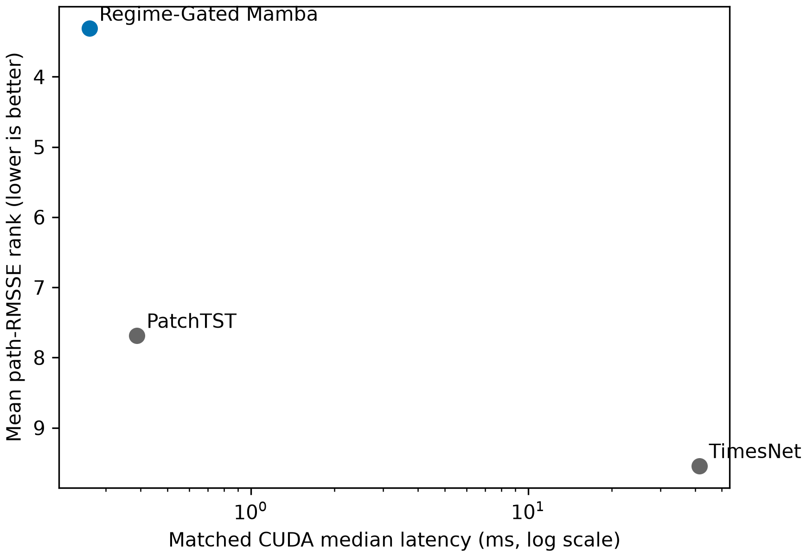

# Computational Profile

The matched CUDA microbenchmark isolates forward-pass latency for Regime-Gated Mamba,
PatchTST, and TimesNet. It is a bounded inference comparison, not an end-to-end
training-cost comparison.

| Model | Median latency (ms) | Throughput (samples/s) | Peak memory (MB) | Parameters |
| --- | ---: | ---: | ---: | ---: |
| Regime-Gated Mamba | 0.2623 | 121,998 | 38.23 | 48,104 |
| PatchTST | 0.3888 | 82,310 | 47.44 | 1,155,132 |
| TimesNet | 41.4511 | 772 | 205.88 | 22,302,656 |

Conditions: `financial_cross_asset_ms`, input length 96, horizon 60, batch size 32,
float32, 20 warm-up iterations, five repeats of 100 iterations, PyTorch 2.13.0 with
CUDA 13.0 on an NVIDIA GeForce RTX 5090 D.

Regime-Gated Mamba is approximately 1.48 times faster than PatchTST and 158 times
faster than TimesNet under these fixed conditions. It also has the smallest measured
parameter count and peak allocated GPU memory of the three. Those comparisons do not
imply faster training, different hardware performance, or a universal accuracy-speed
trade-off.

The raw benchmark is
[`matched_cuda_microbenchmark.csv`](../reproducibility/financial_reference_evaluation_v1/metrics/matched_cuda_microbenchmark.csv).
Regenerate it with the profile command in [reproducibility.md](reproducibility.md).
