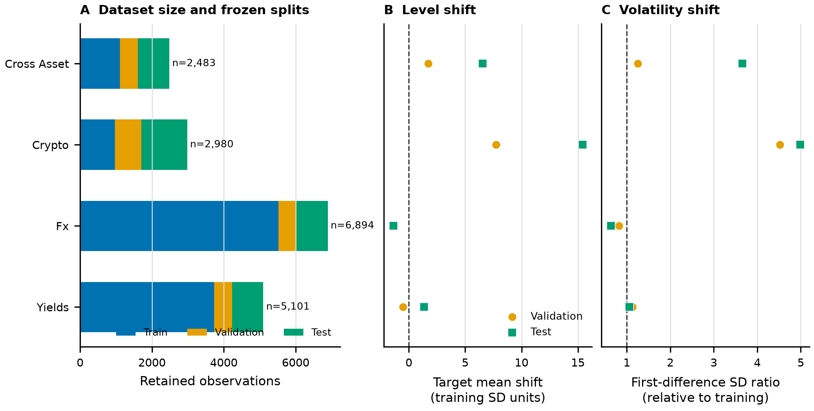

# Current Financial Data

Updated: 2026-08-09

## Main study data

The paper uses four daily financial panels. Each panel defines a target-only (`S`) task
and a multivariate-input, single-target (`MS`) task. The main design therefore contains
four datasets and eight forecasting tasks.

| Panel | Forecast target | Variables available to the MS task | Date range | Rows |
| --- | --- | --- | --- | ---: |
| Cross-asset | GLD | SP500, WTI, VIX, GLD | 2016-07-25 to 2026-06-30 | 2,483 |
| Cryptoasset | BTCUSDT | ETHUSDT, BNBUSDT, XRPUSDT, BTCUSDT | 2018-05-04 to 2026-06-30 | 2,980 |
| Foreign exchange | GBPUSD | EURUSD, CADUSD, JPYUSD, CHFUSD, AUDUSD, GBPUSD | 1999-01-04 to 2026-06-30 | 6,894 |
| Treasury yields | DGS10 | DGS2, DGS5, DGS30, DGS10 | 2006-02-09 to 2026-06-30 | 5,101 |

`S` observes only the target history. `MS` observes all listed variables and is scored
only on the named target. The targets are forecast in levels rather than returns or
first differences.

## Selection and final-test boundaries

| Stage | Training data | Evaluation data | Permitted use |
| --- | --- | --- | --- |
| Development | Through 2020-12-31 | 2021 | Architecture and parameter selection |
| Merge gate | Through 2021-12-31 | 2022 | One locked promotion decision |
| Final financial test | Through 2022-12-31 | 2023-01-01 to 2026-06-30 | Final paper results only |

The R6 promotion report records that the merge-gate targets were read and the
2023-2026 financial targets were not read. This boundary must remain unchanged until
the final model and baseline recipes are frozen.

For the base chronological split, retained row counts are:

| Panel | Through 2020 | 2021-2022 | 2023-2026 |
| --- | ---: | ---: | ---: |
| Cross-asset | 1,112 | 502 | 869 |
| Cryptoasset | 973 | 730 | 1,277 |
| Foreign exchange | 5,521 | 499 | 874 |
| Treasury yields | 3,728 | 500 | 873 |

## Forecast horizons

The full financial evaluation uses 1, 5, 20, 60, 120, and 252 retained observations.

| Horizon group | Steps | Interpretation |
| --- | --- | --- |
| Short | 1, 5 | Immediate movement and persistence |
| Medium | 20, 60 | Monthly to quarterly retained observations |
| Long | 120, 252 | Extended regime and trend behavior |

The 2022 merge gate uses horizons 1, 5, 20, 60, and 120. Horizon 252 is excluded from
selection because the one-year gate does not contain enough complete observations for
the intended boundary. Therefore, current gate references to the long horizon mean
horizon 120 only.

## Evidence of nonstationarity

| Panel | Test mean shift in training SD | Test difference-SD ratio |
| --- | ---: | ---: |
| Cross-asset | +6.53 | 3.66 |
| Cryptoasset | +15.41 | 4.99 |
| Foreign exchange | -1.37 | 0.64 |
| Treasury yields | +1.35 | 1.06 |

These diagnostics establish substantial distribution change in the reference panels.
They do not prove that one model component causes improved forecasts.

## Other downloaded datasets

ETTh1, ETTh2, ETTm1, ETTm2, Electricity, Traffic, Weather, and the public Exchange
dataset are downloaded and hashed in `data/benchmark_download_manifest.json`. They are
not part of the main finance-specific claim. The Exchange dataset is the most relevant
optional supplementary benchmark; the engineering datasets are necessary only if the
paper later makes a cross-domain generalization claim.

## Reproducibility sources

- Task manifest: `data/financial/manifests/training_datasets.json`
- Data-quality report: `data/financial/manifests/quality_report.json`
- Selection-safe diagnostics: `data/financial/manifests/nonstationarity_diagnostics_selection_safe.csv`
- Full descriptive diagnostics: `data/financial/manifests/nonstationarity_diagnostics_full.csv`
- Protocol: `configs/pms_mamba_v3.json`

Raw data should be published only where source terms permit it. Manifests, hashes,
transformations, and exact acquisition instructions remain required for reproduction.
