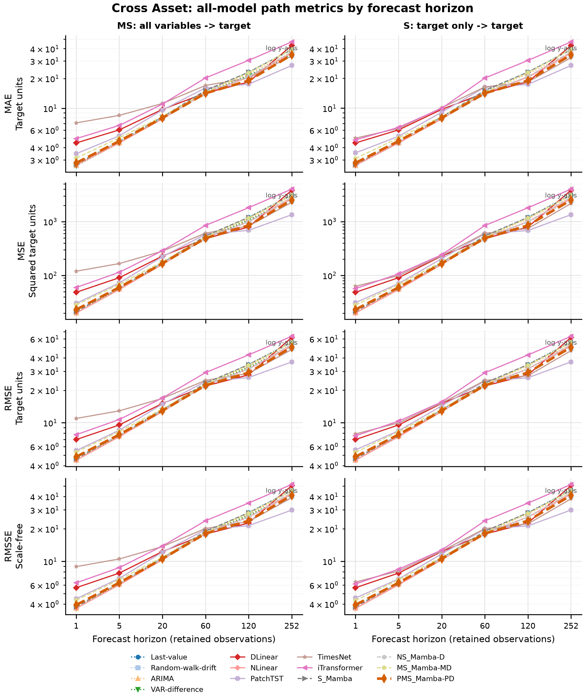
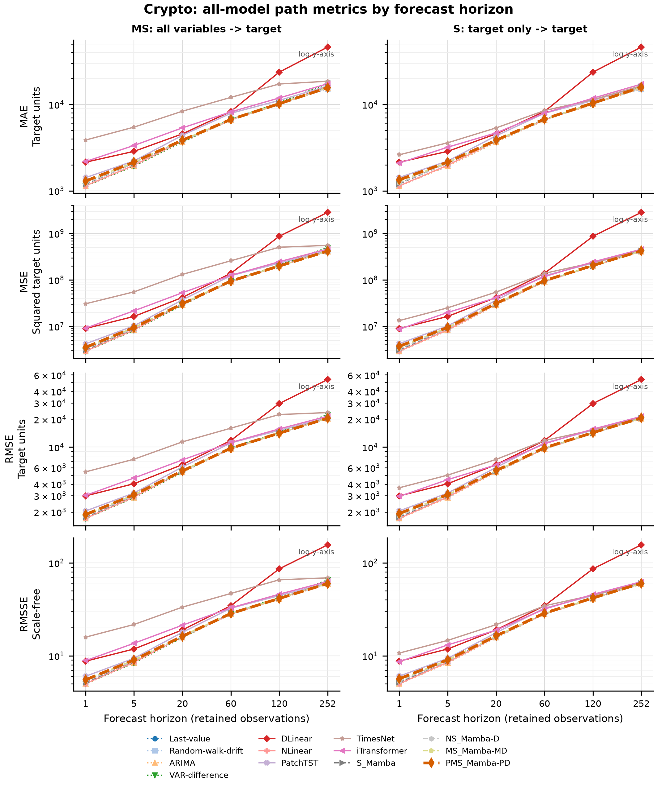
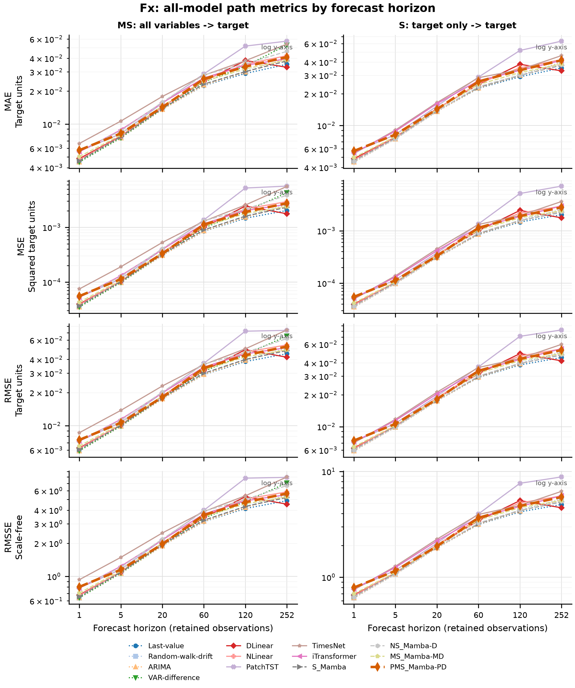
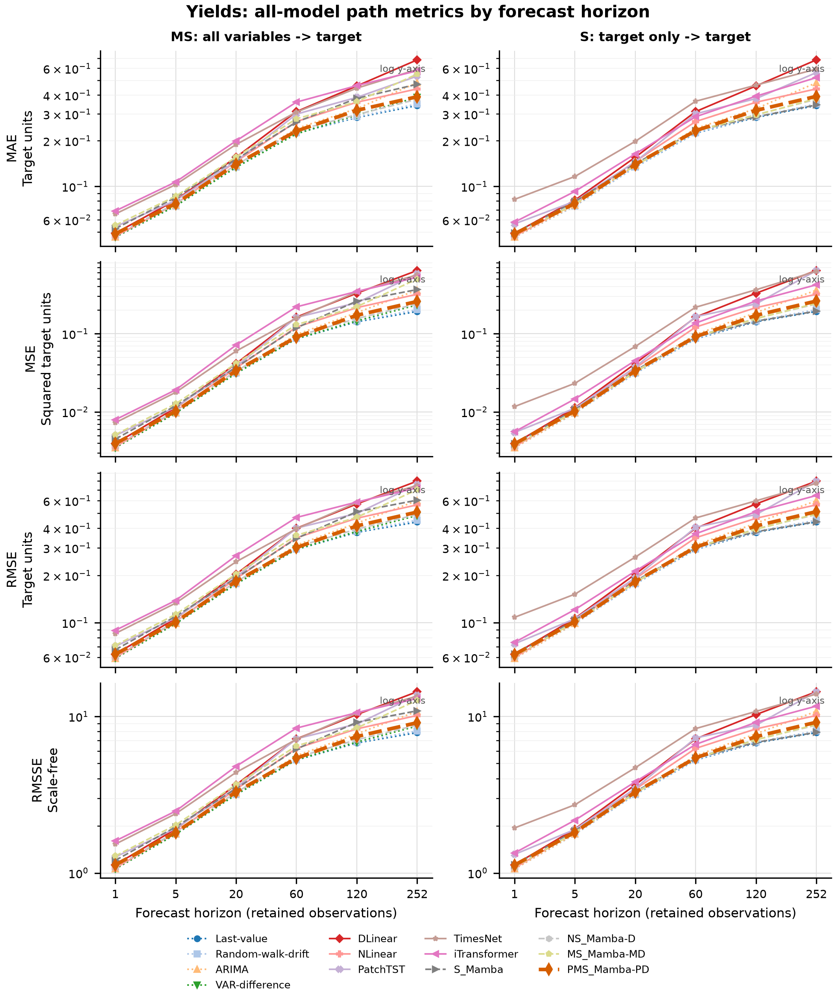

# Current Reference Data

Updated: 2026-08-04

## What data are currently in the study?

The completed benchmark contains **four physical daily reference datasets**. Each
dataset is evaluated as two forecasting tasks: target-only (`S`) and multivariate-input
target forecasting (`MS`). With six forecast horizons, this gives **8 tasks and 48
task-horizon cells**.

These are reference datasets for studying forecasting under nonstationarity. They do
not define the final domain of the project, and the evidence does not establish
cross-domain generalization.

| Dataset | Target | Input variables in MS mode | Date range | Rows |
| --- | --- | --- | --- | ---: |
| Cross-asset | GLD | SP500, WTI, VIX, GLD | 2016-07-25 to 2026-06-30 | 2,483 |
| Cryptoasset | BTCUSDT | ETHUSDT, BNBUSDT, XRPUSDT, BTCUSDT | 2018-05-04 to 2026-06-30 | 2,980 |
| Foreign exchange | GBPUSD | EURUSD, CADUSD, JPYUSD, CHFUSD, AUDUSD, GBPUSD | 1999-01-04 to 2026-06-30 | 6,894 |
| Treasury yields | DGS10 | DGS2, DGS5, DGS30, DGS10 | 2006-02-09 to 2026-06-30 | 5,101 |

`S` uses only the target history. `MS` uses every listed variable as input while the
reported forecast error is for the named target. Targets are stored and evaluated in
levels, not returns or first differences.

Figure 1. Panel A shows retained observations in the frozen chronological splits.
Panels B and C quantify level and first-difference volatility shifts relative to the
training distribution. The test-period points are descriptive final-analysis evidence;
they were not used during model or hyperparameter selection.

## Frozen chronological splits

The split dates are common across all datasets, while row counts differ because the
retained calendars differ.

| Dataset | Train through 2020-12-31 | Validation 2021-01-01 to 2022-12-31 | Test 2023-01-01 to 2026-06-30 |
| --- | ---: | ---: | ---: |
| Cross-asset | 1,112 | 502 | 869 |
| Cryptoasset | 973 | 730 | 1,277 |
| Foreign exchange | 5,521 | 499 | 874 |
| Treasury yields | 3,728 | 500 | 873 |

All processed panels have zero missing cells and zero duplicate dates. Cross-asset,
FX, and yields use complete-case intersections, so they are not complete seven-day
calendars. Crypto uses complete common UTC dates and has a maximum one-day calendar
gap. The other maximum calendar gaps are five days for cross-asset and FX and four
days for yields.

## Forecast horizons and result volume

The frozen horizons are **1, 5, 20, 60, 120, and 252 retained observations**. They are
forecast steps, not identical calendar-day durations across all four panels.

| Group | Horizons | Task-horizon cells |
| --- | --- | ---: |
| Short | 1, 5 | 16 |
| Middle | 20, 60 | 16 |
| Long | 120, 252 | 16 |

## Metric versus horizon for every model

The following figures show every available model at every frozen horizon. Rows are
path MAE, MSE, RMSE, and RMSSE; columns separate multivariate-input (`MS`) and
target-only (`S`) tasks. PMS-Mamba is the thick orange dashed line with diamond
markers. VAR-difference appears only in MS panels because it is not defined for the S
tasks.

All y-axes are logarithmic and labeled explicitly. This is necessary to keep both the
best and worst models visible as error grows with horizon. The x-axis uses six equally
spaced frozen horizon categories; it does not imply equal numerical spacing. MAE,
MSE, and RMSE remain in each target's units and must not be compared vertically across
datasets. RMSSE is scale-free, but model comparisons should still be made within a
task-horizon cell.

### Cross-asset target: GLD

Figure 2. Cross-asset path metrics. PatchTST's advantage is concentrated at the longest
horizons, while PMS-Mamba remains below several other deep baselines over much of the
curve. This concentration explains why PMS can win many pairwise cells against
PatchTST but still lose the balanced cross-asset task summary.

### Cryptoasset target: BTCUSDT

Figure 3. Cryptoasset path metrics. DLinear deteriorates sharply at horizons 120 and
252. PMS-Mamba is close to the leading cluster at long horizons but does not beat the
best statistical reference in the balanced task result.

### Foreign-exchange target: GBPUSD

Figure 4. FX path metrics. Last-value, random-walk drift, and ARIMA form a strong lower
error cluster, especially at short horizons. This is the clearest evidence that the
current PMS design does not control persistence well enough.

### Treasury-yield target: DGS10

Figure 5. Treasury-yield path metrics. PMS-Mamba is competitive with learned models and
improves over NLinear at most long-horizon cells, but Last-value remains stronger in the
balanced task summaries.

The exact values, ranks, cell winners, and percentage gaps behind every plotted point
are in [all-model cell metrics](figures/all_model_cell_metric_gaps.csv). The raw frozen
five-seed aggregates are in
[V1 aggregate metrics](../reproducibility/nonstationary_analysis_v1/final/aggregate_metrics.csv).

The final V1 test release contains:

- 9 learned models, 8 tasks, and 5 seeds: 360 completed model-task-seed cells;
- 2,160 learned model horizon records;
- 4 deterministic statistical or naive references, with VAR-difference available only
  for the 24 multivariate task-horizon cells;
- path and terminal MAE, MSE, RMSE, and RMSSE;
- per-origin predictions retained locally for paired bootstrap regeneration.

## How nonstationary are the targets?

Mean shift is expressed in training-target standard deviations. A first-difference SD
ratio above one means the later period is more volatile than training.

| Dataset | Validation mean shift | Test mean shift | Validation difference-SD ratio | Test difference-SD ratio |
| --- | ---: | ---: | ---: | ---: |
| Cross-asset | +1.71 | +6.53 | 1.25 | 3.66 |
| Cryptoasset | +7.75 | +15.41 | 4.52 | 4.99 |
| Foreign exchange | -1.29 | -1.37 | 0.82 | 0.64 |
| Treasury yields | -0.51 | +1.35 | 1.13 | 1.06 |

The training-level ADF p-values are 0.719, 1.000, 0.682, and 0.363 for cross-asset,
crypto, FX, and yields, respectively; all training-level KPSS p-values are 0.01. Under
their different null hypotheses, this joint pattern is consistent with nonstationary
levels in all four targets. First differencing strongly reduces the ADF evidence of a
unit root. Crypto remains the exception under KPSS after differencing (`p=0.01`), so
first differencing is not evidence that every remaining distributional property is
stable.

The most severe observed shifts are therefore not subtle:

- crypto moves from a training mean of 8,526.74 to a test mean of 66,705.12, a
  15.41-training-SD shift;
- cross-asset GLD moves from a training mean of 133.23 to a test mean of 266.64 while
  first-difference volatility rises to 3.66 times the training value;
- FX shifts downward and becomes less volatile, which helps explain why persistence is
  especially difficult to beat;
- yields reverse from a lower validation level to a substantially higher test level.

These diagnostics describe the data. They do not prove that any one architectural
component causes a model's gains or failures.

## Sources, transformations, and release constraints

| Dataset | Calendar rule | Publication constraint |
| --- | --- | --- |
| Cross-asset | Complete-case intersection of FRED series and GLD | Raw and processed levels remain local pending source-rights review |
| Cryptoasset | Complete common UTC dates | Verify Binance archive terms before public release |
| Foreign exchange | Complete-case intersection; reciprocal conversion for selected FRED series | Public-domain series; citation requested |
| Treasury yields | Complete-case intersection | Public-domain series; citation requested |

The tracked release publishes manifests, hashes, protocol parameters, and frozen result
tables. It should not publish restricted raw data merely to make the repository
self-contained.

## Evidence and exact values

- [Generated dataset summary](figures/dataset_reference_summary.csv)
- [Training task manifest](../data/financial/manifests/training_datasets.json)
- [Data-quality report](../data/financial/manifests/quality_report.json)
- [Selection-safe nonstationarity diagnostics](../data/financial/manifests/nonstationarity_diagnostics_selection_safe.csv)
- [Full descriptive diagnostics](../data/financial/manifests/nonstationarity_diagnostics_full.csv)
- [Frozen benchmark protocol](../configs/financial_benchmark.json)
- [Figure and transformation manifest](figures/detailed_model_comparison.manifest.json)
