# Current Nonstationary Forecasting Results

Updated: 2026-08-04

## Direct answer: what advantage does PMS-Mamba have?

PMS-Mamba has **specific advantages over several learned deep models**, but it has **no
overall benchmark advantage**. Across the 48 frozen task-horizon cells it wins no path
MAE, MSE, RMSE, or RMSSE cell. Its average RMSE/RMSSE rank is 6.625: rank 7/12 among
full-coverage models and rank 4/9 among learned models.

The defensible advantages are these:

| Advantage | Exact evidence | Boundary |
| --- | --- | --- |
| Accuracy versus four deep baselines | Lower mean RMSE than TimesNet in 43/48 cells, iTransformer in 44/48, DLinear in 36/48, and PatchTST in 42/48 | Descriptive cell comparison; concentrated losses still matter |
| Middle-horizon competitiveness | Within 5% of the cell winner in 14/16 horizon-20/60 cells; joint rank 2/9 among learned models by average rank | No cell win; NS-Mamba has the better learned-model rank |
| Long-horizon advantage over NLinear | Lower RMSE in 14/16 horizon-120/252 cells; median difference -4.83% | Does not extend to Last-value, random-walk drift, or NS-Mamba |
| Seed stability | Median seed CV 0.76%, third-lowest of nine learned models | S-Mamba and NS-Mamba are more stable; PMS is slower and uses more memory |
| Multivariate response among Mamba variants | MS lowers PMS RMSSE in 14/24 matched S/MS pairs; mean MS-minus-S is -0.073 | Modest and inconsistent; not a general multivariate superiority claim |
| V2 residual anchoring direction | F01 validation RMSSE improves 1.79% overall and 7.06% at short horizons | Validation only and below the frozen 2% replacement threshold |

The main non-advantages are equally clear: PMS-Mamba is lower-RMSE than Last-value in
only 8/48 cells, ARIMA in 14/48, random-walk drift in 2/48, and NS-Mamba in 17/48.
It also has the second-slowest median runtime and third-highest peak memory among the nine
learned models. The paper must therefore describe a bounded accuracy and stability
advantage over selected learned baselines, not state-of-the-art superiority.

## Direct RMSE comparison against every model

The signed difference is `100 * (PMS RMSE / comparator RMSE - 1)`. Negative values
favor PMS-Mamba. Cell counts use the five-seed mean within each task and horizon.

| Comparator | Type | PMS lower RMSE | Median difference | What the comparison says |
| --- | --- | ---: | ---: | --- |
| TimesNet | Learned | 43/48 | -23.58% | Clear descriptive PMS advantage |
| iTransformer | Learned | 44/48 | -18.42% | Clear descriptive PMS advantage |
| DLinear | Learned | 36/48 | -14.34% | Broad PMS advantage except concentrated cells |
| PatchTST | Learned | 42/48 | -8.29% | PMS usually lower, but PatchTST wins both balanced cross-asset tasks |
| MS-Mamba | Mamba | 25/48 | -0.17% | Near parity |
| NLinear | Learned | 24/48 | +0.26% | Exact split and near parity overall |
| S-Mamba | Mamba | 19/48 | +0.94% | Small median PMS deficit |
| NS-Mamba | Mamba | 17/48 | +1.04% | Small but broad PMS deficit |
| VAR-difference | Statistical | 8/24 | +2.71% | PMS behind on available multivariate cells overall |
| ARIMA | Statistical | 14/48 | +3.17% | PMS behind overall; competitive only at long horizons |
| Random-walk drift | Naive | 2/48 | +3.45% | Major persistence/change deficit |
| Last-value | Naive | 8/48 | +3.77% | Major persistence deficit |

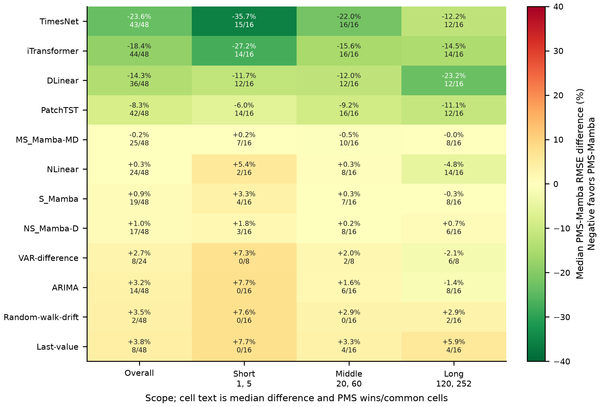

Advantage overview. Signed median RMSE difference and PMS-Mamba cell wins against every
comparator, overall and separately for short, middle, and long horizons. Green negative
values favor PMS-Mamba. The figure makes the boundary explicit: the advantage over
TimesNet, iTransformer, DLinear, and PatchTST persists across terms, while short-term
persistence and statistical references remain stronger.

The complete current data description is in [Current reference data](current_data.md).

## Evidence boundary

The immutable V1 final analysis covers the protected 2023-01-01 through 2026-06-30
period and contains:

- 4 financial reference panels and 8 target-only/multivariate tasks;
- 9 learned models, up to 4 deterministic statistical or naive references, and 6
  horizons: 1, 5, 20, 60, 120, and 252;
- 360 learned model-task-seed cells and 2,160 learned horizon records;
- path and terminal MAE, MSE, RMSE, and RMSSE; five-seed variation; runtime;
  regime summaries; and 10,000-replicate moving-block bootstrap contrasts with Holm
  correction.

V2 is a separate validation-only optimization study. It did not reopen the protected
test targets and must not be described as confirmatory test performance.

## Metrics and comparison rule

| Metric | Scale | What it emphasizes | Comparison in this report |
| --- | --- | --- | --- |
| MAE | Original target units | Typical absolute error; less dominated by large errors | Within the same task and horizon |
| MSE | Squared target units | Large errors receive quadratic weight | Within the same task and horizon |
| RMSE | Original target units | Large errors receive more weight than MAE | Within the same task and horizon |
| RMSSE | Scale-free ratio | RMSE relative to a training-set naive-difference scale | Primary cross-task metric |

Raw MAE, MSE, and RMSE values are not comparable across cross-asset prices, crypto
prices, FX rates, and Treasury yields because their units and magnitudes differ. The
overall position analysis therefore uses the rank and percentage gap within each
task-horizon cell. Task-level tables retain raw values because every comparison within
a row shares a target and unit.

RMSE and RMSSE have exactly the same winner, rank, and percentage gap in every frozen
cell: the RMSSE denominator is shared by all models in a cell. MSE also has the same
winner and rank in this snapshot, while its percentage gaps are larger because errors
are squared. These are complementary error scales, not three independent model-win
experiments.

## PMS-Mamba position across metrics

| Path metric | Wins | Top 3 | Average rank | Median rank | Median gap | Mean gap | Within 5% |
| --- | ---: | ---: | ---: | ---: | ---: | ---: | ---: |
| MAE | 0/48 | 3/48 | 6.750 | 7 | 6.41% | 9.94% | 18/48 |
| MSE | 0/48 | 3/48 | 6.625 | 7 | 14.29% | 20.72% | 9/48 |
| RMSE | 0/48 | 3/48 | 6.625 | 7 | 6.91% | 9.51% | 22/48 |
| RMSSE | 0/48 | 3/48 | 6.625 | 7 | 6.91% | 9.51% | 22/48 |

The secondary terminal endpoint is similarly middle-ranked:

| Terminal metric | Wins | Top 3 | Average rank | Median gap | Mean gap | Within 5% |
| --- | ---: | ---: | ---: | ---: | ---: | ---: |
| MAE | 0/48 | 8/48 | 6.458 | 6.98% | 13.37% | 18/48 |
| MSE | 1/48 | 5/48 | 6.521 | 13.27% | 28.66% | 10/48 |
| RMSE | 1/48 | 5/48 | 6.521 | 6.43% | 12.32% | 20/48 |
| RMSSE | 1/48 | 5/48 | 6.521 | 6.43% | 12.32% | 20/48 |

The isolated terminal wins do not change the path-based conclusion.

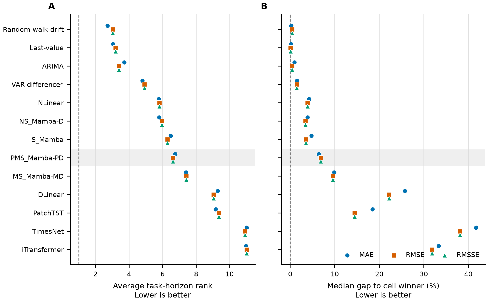

Figure 1. Average task-horizon rank and median percentage gap to the cell winner for
all models. Lower is better. MAE, RMSE, and RMSSE use 48 cells per model except
VAR-difference, which is defined only for the 24 multivariate cells. The gray band marks
PMS-Mamba. RMSE and RMSSE markers overlap because their within-cell positions are
identical.

The figure resolves an apparent contradiction in the pooled values. PMS-Mamba has the
lowest descriptive pooled mean RMSSE among the nine learned models, but it is fourth
among learned models by average cell rank, behind NLinear, NS-Mamba, and S-Mamba.
The pooled mean is disproportionately influenced by datasets with large RMSSE values;
the cell rank is the more defensible answer to "where is the model?"

## Descriptive pooled values

| Quantity | PMS-Mamba result | Interpretation |
| --- | ---: | --- |
| Mean path RMSSE across 48 cells | 12.967 | Descriptive pooled value only |
| Median path RMSSE | 6.023 | Descriptive pooled value only |
| Average path-RMSSE cell rank | 6.625 | Rank 7/12 among full-coverage models |
| Path-RMSSE wins | 0/48 | No primary cell win |
| Path-RMSSE top-three cells | 3/48 | Concentrated at middle horizons |
| Terminal-RMSSE wins | 1/48 | One terminal-lead win does not change the primary result |
| Positive skill versus Last-value | 8/48 | Persistence remains difficult to beat |
| Median seed coefficient of variation | 0.76% | Training is comparatively stable |
| Maximum seed coefficient of variation | 7.58% | No pervasive seed-instability failure |

The pooled mean path RMSSE of 12.967 is the second-lowest descriptive mean among
models evaluated in all 48 cells, behind Random-walk-drift at 12.677. This is not a
valid "second place" claim: pooling mixes heterogeneous tasks and horizons, whereas
the prespecified primary comparison is the winner within each task-horizon cell.

Naive or statistical references won 38/48 path-RMSSE cells and non-Mamba learned
models won 10/48; all Mamba variants together won 0/48.

## Performance by task

Balanced path RMSSE is the unweighted mean of short-, middle-, and long-term mean
path RMSSE within a task. Lower is better.

| Task | PMS-Mamba | Winner | Winner score | PMS rank | Gap |
| --- | ---: | --- | ---: | ---: | ---: |
| Cross-asset MS | 17.254 | PatchTST | 15.744 | 2/13 | 9.59% |
| Cross-asset S | 17.255 | PatchTST | 15.698 | 2/12 | 9.92% |
| Crypto MS | 26.788 | ARIMA | 26.215 | 7/13 | 2.18% |
| Crypto S | 27.053 | ARIMA | 26.215 | 8/12 | 3.20% |
| FX MS | 2.985 | Last-value | 2.625 | 7/13 | 13.72% |
| FX S | 2.997 | Last-value | 2.625 | 8/12 | 14.16% |
| Yields MS | 4.695 | Last-value | 4.315 | 5/13 | 8.82% |
| Yields S | 4.707 | Last-value | 4.315 | 6/12 | 9.10% |

Cross-asset is PMS-Mamba's clearest task-level strength. Crypto is numerically close
to the winner but ranks behind several simple references. FX is the weakest task family
because Last-value remains substantially better. Yields is intermediate, but the same
persistence problem remains.

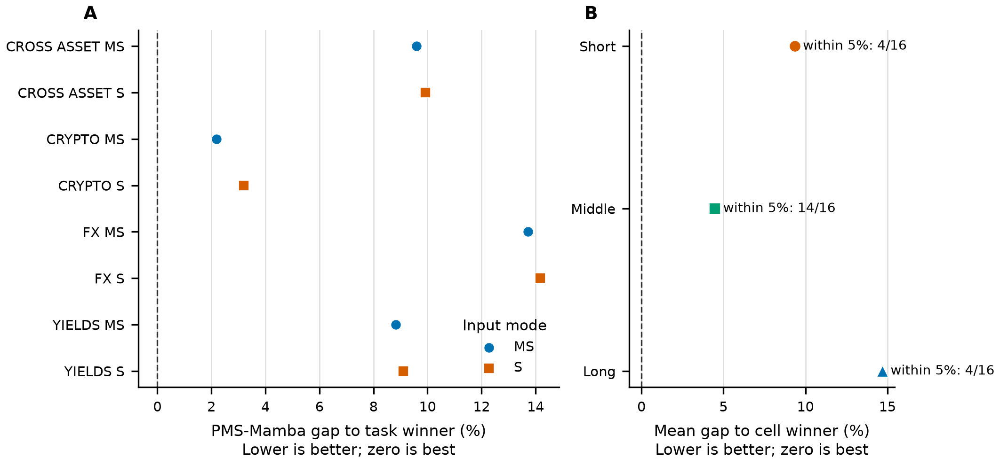

Figure 2. Panel A reports the percentage gap between PMS-Mamba and each task's balanced
path-RMSSE winner. Panel B reports the mean gap to the winner over the 16 cells in each
horizon group. These are descriptive five-seed test means; no uncertainty interval is
shown. Underlying values and provenance are in `docs/figures/`.

### Task-balanced MAE

Values are in each task's original target units and therefore must be read row by row.

| Task | PMS-Mamba MAE | Winner | Winner MAE | PMS rank | Gap |
| --- | ---: | --- | ---: | ---: | ---: |
| Cross-asset MS | 13.871 | PatchTST | 13.151 | 2/13 | 5.48% |
| Cross-asset S | 13.872 | PatchTST | 13.093 | 2/12 | 5.95% |
| Crypto MS | 6,637.802 | Random-walk-drift | 6,396.257 | 5/13 | 3.78% |
| Crypto S | 6,721.253 | Random-walk-drift | 6,396.257 | 8/12 | 5.08% |
| FX MS | 0.02144 | Last-value | 0.01872 | 7/13 | 14.52% |
| FX S | 0.02158 | Last-value | 0.01872 | 9/12 | 15.28% |
| Yields MS | 0.2006 | Last-value | 0.1840 | 5/13 | 9.02% |
| Yields S | 0.2010 | Last-value | 0.1840 | 6/12 | 9.25% |

### Task-balanced RMSE

| Task | PMS-Mamba RMSE | Winner | Winner RMSE | PMS rank | Gap |
| --- | ---: | --- | ---: | ---: | ---: |
| Cross-asset MS | 21.167 | PatchTST | 19.315 | 2/13 | 9.59% |
| Cross-asset S | 21.168 | PatchTST | 19.259 | 2/12 | 9.92% |
| Crypto MS | 9,133.586 | ARIMA | 8,938.367 | 7/13 | 2.18% |
| Crypto S | 9,224.202 | ARIMA | 8,938.367 | 8/12 | 3.20% |
| FX MS | 0.02761 | Last-value | 0.02428 | 7/13 | 13.72% |
| FX S | 0.02772 | Last-value | 0.02428 | 8/12 | 14.16% |
| Yields MS | 0.2613 | Last-value | 0.2401 | 5/13 | 8.82% |
| Yields S | 0.2620 | Last-value | 0.2401 | 6/12 | 9.10% |

The RMSSE table above has the same winners, ranks, and percentage gaps as RMSE, while
reporting scale-free values. MAE differs in crypto: Random-walk-drift has the lowest
balanced absolute error, whereas ARIMA has the lowest balanced squared-error scale.

## Every PMS-Mamba task-horizon result

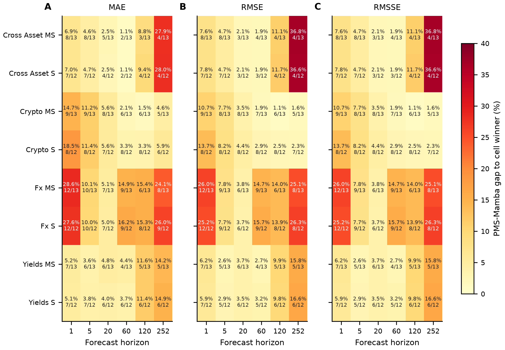

Figure 3. PMS-Mamba's percentage gap to the best model in every task-horizon cell.
Each cell also gives PMS-Mamba's rank and the number of eligible models. All panels use
the same 0-40% color scale. These are descriptive five-seed means without uncertainty
intervals.

The detailed pattern is not simply "short bad, long bad":

- Cross-asset improves from about 7-8% behind at horizon 1 to 1.9% behind at horizon
  60, then deteriorates to 36.6-36.8% behind at horizon 252.
- Crypto improves with horizon. Its RMSE gap falls from 10.7-13.7% at horizon 1 to
  1.6-2.3% at horizon 252.
- FX is weak at horizon 1 and from 60 onward; horizon 20 is its closest region at
  3.7-3.8% behind.
- Yields is closest at horizons 5-60 and degrades at horizons 120 and 252.

Thus the largest long-horizon problem is concentrated in cross-asset and yields rather
than crypto. The current evidence identifies the location of failure but does not by
itself prove a specific architectural cause.

## Separate short-, middle-, and long-term comparisons

| Horizon group | Cells | Mean gap to winner | Median gap | Within 5% | Top three |
| --- | ---: | ---: | ---: | ---: | ---: |
| Short: 1, 5 | 16 | 9.34% | 7.72% | 4/16 | 0/16 |
| Middle: 20, 60 | 16 | 4.49% | 3.36% | 14/16 | 3/16 |
| Long: 120, 252 | 16 | 14.69% | 12.82% | 4/16 | 0/16 |

The primary figures below use path RMSSE because it is scale-free and was the frozen
primary evaluation metric. The same separation is not an RMSSE-only conclusion:

| Horizon group | Path metric | Average rank | Median gap | Within 5% | Top three |
| --- | --- | ---: | ---: | ---: | ---: |
| Short | MAE | 8.438 | 8.49% | 4/16 | 0/16 |
| Short | MSE | 8.062 | 16.04% | 0/16 | 0/16 |
| Short | RMSE | 8.062 | 7.72% | 4/16 | 0/16 |
| Short | RMSSE | 8.062 | 7.72% | 4/16 | 0/16 |
| Middle | MAE | 6.000 | 4.19% | 11/16 | 2/16 |
| Middle | MSE | 5.938 | 6.84% | 5/16 | 3/16 |
| Middle | RMSE | 5.938 | 3.36% | 14/16 | 3/16 |
| Middle | RMSSE | 5.938 | 3.36% | 14/16 | 3/16 |
| Long | MAE | 5.812 | 12.92% | 3/16 | 1/16 |
| Long | MSE | 5.875 | 27.34% | 4/16 | 0/16 |
| Long | RMSE | 5.875 | 12.82% | 4/16 | 0/16 |
| Long | RMSSE | 5.875 | 12.82% | 4/16 | 0/16 |

RMSE and RMSSE have identical within-cell ranks and percentage gaps because the RMSSE
denominator is common to all eligible models in a task-horizon cell. MSE retains the
same ordering but magnifies relative gaps. MAE has a slightly different ordering, yet
it leads to the same diagnosis: middle-term performance is closest to the winner,
while short- and long-term performance are weaker.

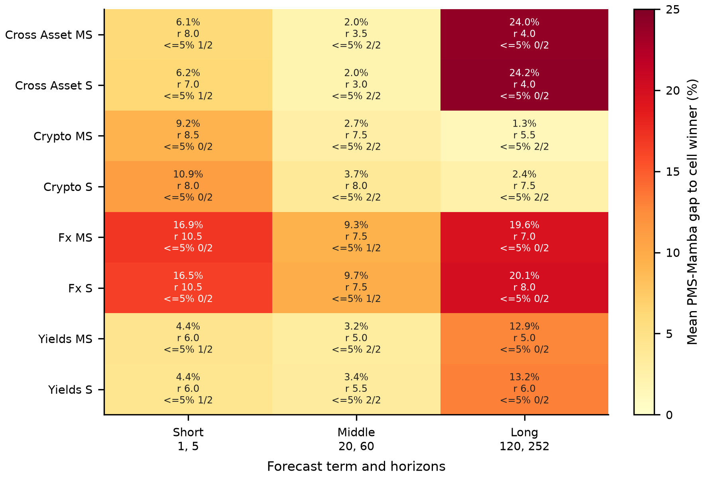

Figure 4. PMS-Mamba's mean path-RMSSE gap, average rank, and number of horizons within
5% of the cell winner, separated by task and forecast term. Every term contains exactly
two horizons. The color scale is shared across all three terms. Values are descriptive
five-seed means without new uncertainty intervals.

### Short-term results: horizons 1 and 5

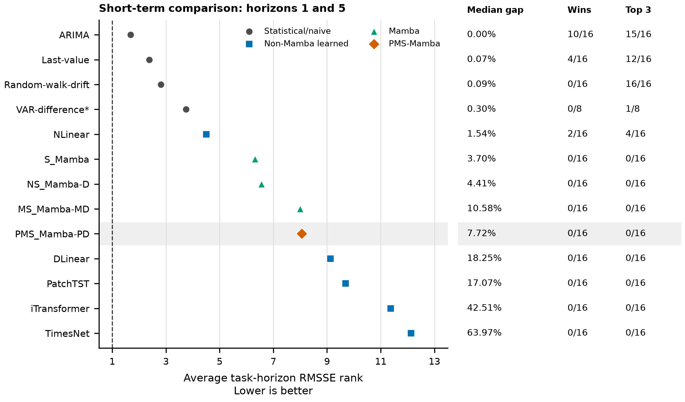

Figure 5. Short-term comparison across the 16 task-horizon cells. The left panel orders
models by average within-cell RMSSE rank; the aligned columns report median gap to the
winner, cell wins, and Top-3 placements. PMS-Mamba is highlighted. VAR-difference uses
the 8 multivariate cells; every other model uses 16.

PMS-Mamba's short-term average rank is 8.062: rank 8/12 among full-coverage models and
rank 5/9 among learned models. It has no wins or Top-3 cells, a 7.72% median gap, and
only 4/16 cells within 5% of the winner. ARIMA wins 10/16 short-term cells, Last-value
wins 4/16, and NLinear wins 2/16. Random-walk-drift is Top-3 in all 16 cells despite
having no outright win.

The alternative path metrics do not improve this conclusion. PMS-Mamba's short-term
MAE average rank is 8.438 with an 8.49% median gap, while its MSE median gap is 16.04%.

The task split shows where the short-term deficit occurs. PMS-Mamba's mean gap is
4.4% on yields, 6.1-6.2% on cross-asset, 9.2-10.9% on crypto, and 16.5-16.9% on FX.
The short-term optimization problem is therefore primarily persistence control on FX,
not a uniform failure across all datasets.

### Middle-term results: horizons 20 and 60

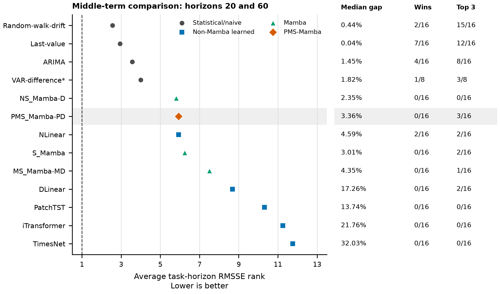

Figure 6. Middle-term comparison using the same definitions as Figure 5. The figure is
separate so the complete model ordering, gap, wins, and Top-3 counts remain readable.

This is PMS-Mamba's strongest interval. Its average rank is 5.938, tied with NLinear:
joint rank 5/12 among full-coverage models and joint rank 2/9 among learned models,
behind NS-Mamba among learned models. It has 3/16 Top-3 cells, a 3.36% median gap, and
14/16 cells within 5% of the winner. The 16 winners are Last-value (7), ARIMA (4),
Random-walk-drift (2), NLinear (2), and VAR-difference (1).

PMS-Mamba is about 2.0% behind on cross-asset, 2.7-3.7% on crypto, and 3.2-3.4% on
yields. FX remains the exception at 9.3-9.7%. The main defensible positive result is
therefore broad middle-term competitiveness, not overall dominance.

This is also the strongest term under the other path metrics: the MAE median gap is
4.19% with 11/16 cells within 5%, and the MSE median gap is 6.84%.

### Long-term results: horizons 120 and 252

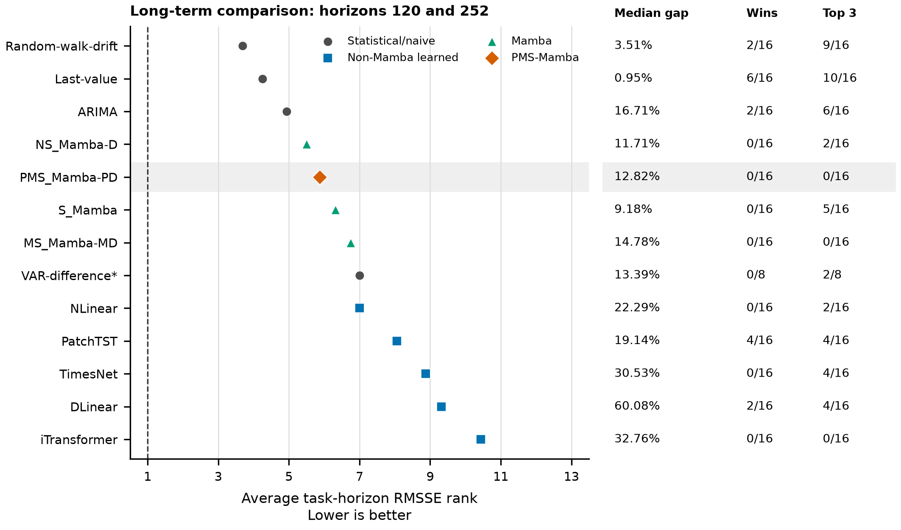

Figure 7. Long-term comparison using the same definitions as Figures 5 and 6.

PMS-Mamba's average rank improves to 5.875: rank 5/12 among full-coverage models and
rank 2/9 among learned models, behind NS-Mamba. However, it has no wins or Top-3 cells,
its median gap is 12.82%, and only 4/16 cells are within 5% of the winner. Last-value
wins 6/16 long-term cells, PatchTST 4/16, and Random-walk-drift, ARIMA, and DLinear
each win 2/16.

The apparent improvement in rank must not be confused with closeness to the winner.
Long-term crypto is competitive at a mean gap of 1.3-2.4%, while cross-asset is
24.0-24.2% behind, FX is 19.6-20.1% behind, and yields is 12.9-13.2% behind. The next
model version therefore needs task-conditioned long-range behavior rather than a
single global long-horizon correction.

MAE confirms the long-term weakness despite a slightly better 5.812 average rank: its
median gap is 12.92% and only one cell is Top-3. The MSE median gap expands to 27.34%,
showing that the largest long-term misses are consequential under squared error.

## Complete task-level model landscape

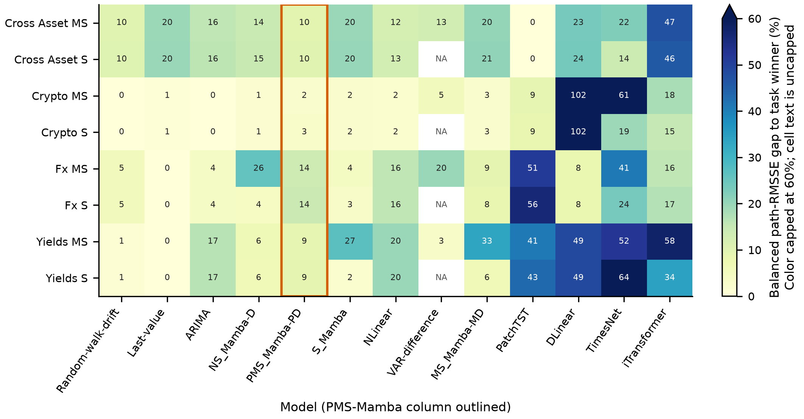

Figure 8. Balanced path-RMSSE percentage gap from the task winner for every available
model. Cell text is the exact rounded gap; the color scale is capped at 60% and the
triangle marks larger values. `NA` means VAR-difference is structurally unavailable
for target-only tasks. The outlined PMS-Mamba column shows its position relative to
the full field.

PatchTST leads both cross-asset tasks, Last-value leads FX and yields, and ARIMA narrowly
leads crypto on balanced RMSSE. PMS-Mamba is second on cross-asset but only middle-ranked
on the other six tasks. Its task-balanced gap is never zero and ranges from 2.18% on
crypto MS to 14.16% on FX S.

## PMS-Mamba against every comparator

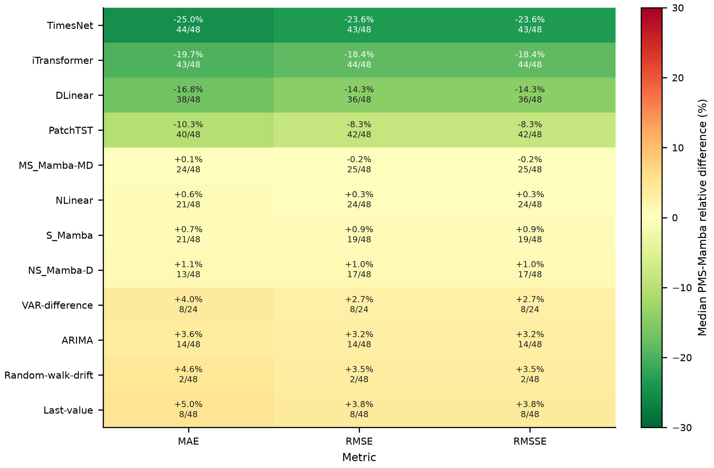

Figure 9. Median relative metric difference between PMS-Mamba and every comparator.
Negative green values favor PMS-Mamba; positive red values favor the comparator. Each
cell also reports the number of task-horizon cells won by PMS-Mamba over the number of
common cells. VAR-difference has only 24 multivariate comparisons.

The horizon split shows whether an overall comparison is broad or localized. Each
entry is `median signed RMSE difference; PMS wins/common cells`.

| Comparator | Short: 1, 5 | Middle: 20, 60 | Long: 120, 252 |
| --- | ---: | ---: | ---: |
| TimesNet | -35.73%; 15/16 | -21.99%; 16/16 | -12.17%; 12/16 |
| iTransformer | -27.25%; 14/16 | -15.56%; 16/16 | -14.50%; 14/16 |
| DLinear | -11.73%; 12/16 | -11.95%; 12/16 | -23.23%; 12/16 |
| PatchTST | -6.05%; 14/16 | -9.17%; 16/16 | -11.15%; 12/16 |
| MS-Mamba | +0.16%; 7/16 | -0.51%; 10/16 | -0.04%; 8/16 |
| NLinear | +5.36%; 2/16 | +0.33%; 8/16 | -4.83%; 14/16 |
| S-Mamba | +3.30%; 4/16 | +0.29%; 7/16 | -0.26%; 8/16 |
| NS-Mamba | +1.75%; 3/16 | +0.23%; 8/16 | +0.68%; 6/16 |
| VAR-difference | +7.32%; 0/8 | +2.01%; 2/8 | -2.12%; 6/8 |
| ARIMA | +7.72%; 0/16 | +1.58%; 6/16 | -1.43%; 8/16 |
| Random-walk drift | +7.57%; 0/16 | +2.85%; 0/16 | +2.90%; 2/16 |
| Last-value | +7.66%; 0/16 | +3.32%; 4/16 | +5.91%; 4/16 |

This table identifies three different mechanisms. First, the advantage over the four
weaker deep baselines is present in every term and is not an artifact of one horizon.
Second, the comparison with NLinear reverses: PMS loses 14/16 short cells but wins
14/16 long cells. Third, ARIMA also reverses at long horizons, whereas Last-value and
random-walk drift remain difficult throughout. PMS-Mamba therefore needs a short-term
persistence controller without sacrificing its relative long-range behavior.

This explains why PMS-Mamba can have lower mean RMSE than PatchTST in 42/48 cells while
still losing both cross-asset task summaries: PatchTST's advantage is concentrated in
the cells that determine those task-balanced results. A win count alone does not measure
the magnitude or location of wins.

These all-model head-to-head counts are descriptive and no new all-pair p-values were
computed. Statistical interpretation remains limited to the prespecified bootstrap
contrasts in the next section, which retain their original Holm correction families.

## Prespecified pairwise and multivariate evidence

Against S-Mamba, PMS-Mamba has 9 significantly favorable cells, 13 significantly
unfavorable cells, and 26 cells without a Holm-adjusted significant difference.
Against the validation-selected non-Mamba learned comparator, the counts are 15
favorable, 6 unfavorable, and 27 not significant.

The selected learned comparator is NLinear for cross-asset and crypto, PatchTST for
FX, and DLinear for yields, in both S and MS modes. The family-specific selection was
frozen on validation data before the protected test period was opened.

These paired results show that PMS-Mamba adds value in some cells, but they do not
overturn the full-comparator winner matrix because naive and statistical references
remain part of the benchmark.

Multivariate input lowers PMS-Mamba RMSSE in 14/24 matched S/MS family-horizon pairs,
with a mean MS-minus-S RMSSE of -0.073. The effect is modest and inconsistent; the
current evidence does not justify a general claim that additional covariates always
help.

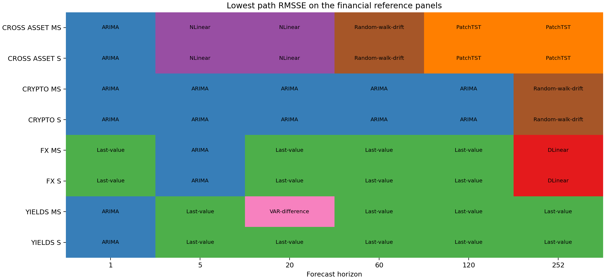

Figure 10. Lowest five-seed mean path RMSSE in each V1 task-horizon cell. The absence of
a Mamba label is the central negative result: naive/statistical models win 38 cells and
non-Mamba learned models win 10.

## Stability and computational cost

PMS-Mamba's stability advantage over several learned baselines is real, but it is not
free. Seed CV is computed across five final seeds within each task-horizon cell. Runtime
is the recorded median for one horizon-specific train/evaluation run.

| Model | Median seed CV | Median runtime | Maximum peak GPU memory |
| --- | ---: | ---: | ---: |
| S-Mamba | 0.44% | 5.38 s | 77.0 MB |
| NS-Mamba | 0.55% | 13.68 s | 96.7 MB |
| **PMS-Mamba** | **0.76%** | **19.57 s** | **328.9 MB** |
| MS-Mamba | 0.81% | 16.67 s | 133.7 MB |
| NLinear | 1.12% | 0.48 s | 70.3 MB |
| iTransformer | 2.38% | 3.77 s | 90.8 MB |
| PatchTST | 4.48% | 3.24 s | 333.5 MB |
| DLinear | 5.42% | 0.68 s | 67.4 MB |
| TimesNet | 6.37% | 79.82 s | 2,054.3 MB |

PMS-Mamba is third-best by median seed CV and is more stable than every non-Mamba
learned model in this benchmark. It is nevertheless the slowest model other than
TimesNet and has the third-highest maximum peak memory. The current evidence supports
a stability claim and an efficiency claim against TimesNet, not a general efficiency
claim against Transformer models. The complete 2,160-run profile, including all model,
horizon, and task distributions, is in the
[computational profile](computational_profile.md).

## V2 validation-only optimization

V2 screened 8 configurations over 8 tasks, 3 seeds, and 6 horizons, producing 1,152
complete validation records. F01 and F03 were then compared with the current F04
configuration over five seeds, producing 720 complete records.

| Candidate | Overall improvement vs F04 | Short | Middle | Long | Decision |
| --- | ---: | ---: | ---: | ---: | --- |
| F01 | 1.79% | 7.06% | 2.04% | 0.84% | Below 2% threshold |
| F03 | 1.68% | 7.29% | 1.92% | 0.70% | Below 2% threshold |

F01's descriptive 95% paired task-seed bootstrap interval for overall improvement was
1.51% to 2.02%; F03's was 1.20% to 2.13%. Selection used the prespecified point-estimate
rule, not whether an interval crossed 2%. Neither finalist achieved at least 2% lower
mean balanced RMSSE, so F04 was retained and no new locked-test run was opened.

| Screen factor, high minus low | Effect on balanced RMSSE | Direction |
| --- | ---: | --- |
| Residual target minus direct level | -1.77% | Favorable |
| Scale MSE minus MSE | +6.11% | Unfavorable |
| Gate minus mean fusion | +0.52% | Slightly unfavorable |
| Late-step minus uniform weighting | +0.21% | Slightly unfavorable |

The V2 fractional design aliases main effects with three-factor interactions, so these
factor effects are diagnostic rather than confirmatory. The reliable design signal is
to continue investigating residual anchoring; the current `SCALE_MSE`, gate, and
late-step weighting should not be promoted unchanged.

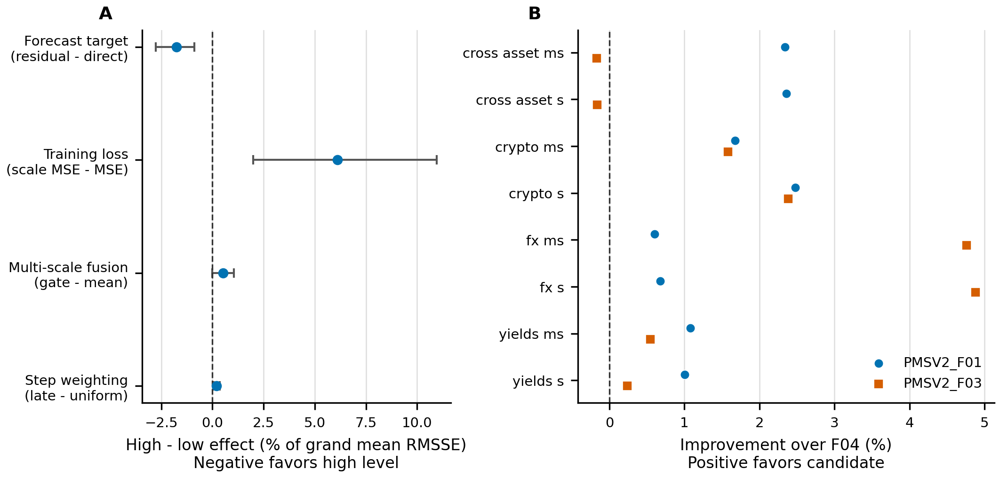

Figure 11. Panel A shows descriptive high-minus-low screen effects with paired bootstrap
intervals. Panel B shows five-seed task-level improvements of F01 and F03 over F04.
This is validation-only evidence.

## Current scientific interpretation

1. PMS-Mamba is fourth of nine learned models by average cell rank and seventh of the
   twelve full-coverage models; it is competitive but not a leading overall model.
2. It is clearly stronger than TimesNet, iTransformer, DLinear, and usually PatchTST,
   but it is close to NLinear/MS-Mamba and behind persistence/statistical references.
3. Cross-asset task-balanced rank and middle horizons are its strongest regions.
4. Cross-asset horizon 252, FX, and long-horizon yields are the clearest optimization
   targets; crypto long horizons are comparatively close to the winner.
5. Residual anchoring is the only favorable V2 factor worth carrying forward directly.

## Evidence links

- [Current dataset description](current_data.md)
- [Generated dataset summary](figures/dataset_reference_summary.csv)
- [V1 final report](../reproducibility/nonstationary_analysis_v1/final/REPORT.md)
- [V1 aggregate metrics](../reproducibility/nonstationary_analysis_v1/final/aggregate_metrics.csv)
- [V1 bootstrap contrasts](../reproducibility/nonstationary_analysis_v1/final/bootstrap_contrasts.csv)
- [All 4,800 path/terminal model-cell-metric comparisons](figures/all_model_cell_metric_gaps.csv)
- [All-model metric position summary](figures/model_metric_position_summary.csv)
- [All-model short/middle/long metric summary](figures/term_model_metric_summary.csv)
- [PMS-Mamba task-by-term summary](figures/pms_mamba_term_task_summary.csv)
- [PMS-Mamba against every comparator](figures/pms_mamba_head_to_head.csv)
- [PMS-Mamba RMSE comparison by term](figures/pms_mamba_rmse_advantage_by_term.csv)
- [PMS-Mamba RMSE comparison by task](figures/pms_mamba_rmse_advantage_by_task.csv)
- [Task-balanced model metrics](figures/task_model_metric_summary.csv)
- [Complete computational profile](computational_profile.md)
- [All 2,160 run-level runtime and memory records](../reproducibility/nonstationary_analysis_v1/final/neural_metrics_by_seed.csv)
- [Model-level computational summary](figures/computational_profile_model_summary.csv)
- [Horizon-level computational summary](figures/computational_profile_by_horizon.csv)
- [Task-level computational summary](figures/computational_profile_by_task.csv)
- [PMS-Mamba efficiency comparison](figures/pms_mamba_efficiency_comparison.csv)
- [Figure and transformation manifest](figures/detailed_model_comparison.manifest.json)
- [V2 analysis report](../reproducibility/nonstationary_analysis_v2/analysis/REPORT.md)
- [V2 frozen selection](../reproducibility/nonstationary_analysis_v2/selection/selection_manifest.json)
