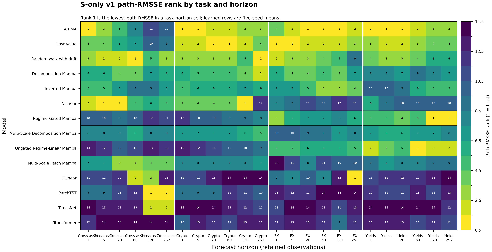
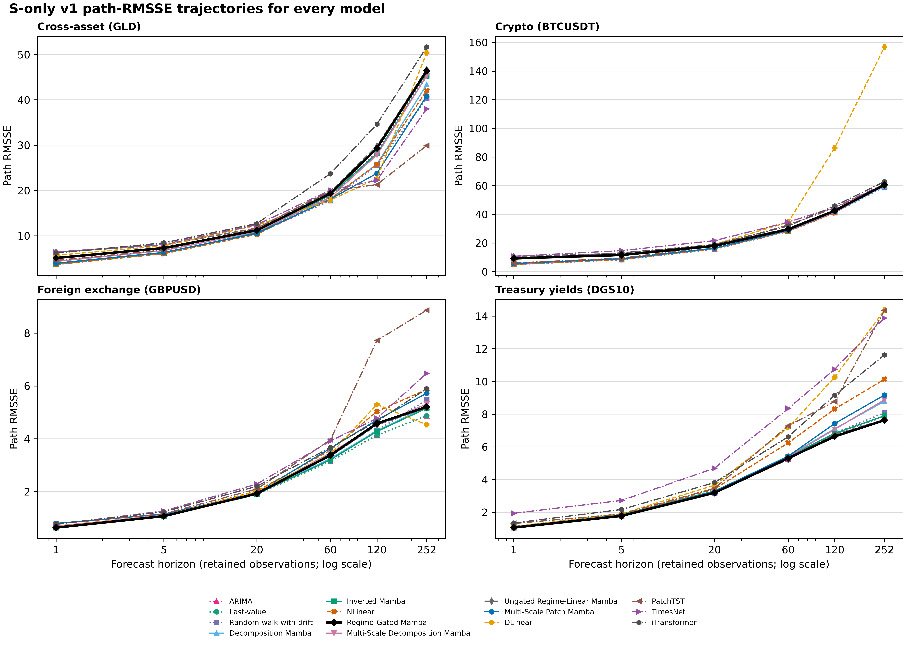
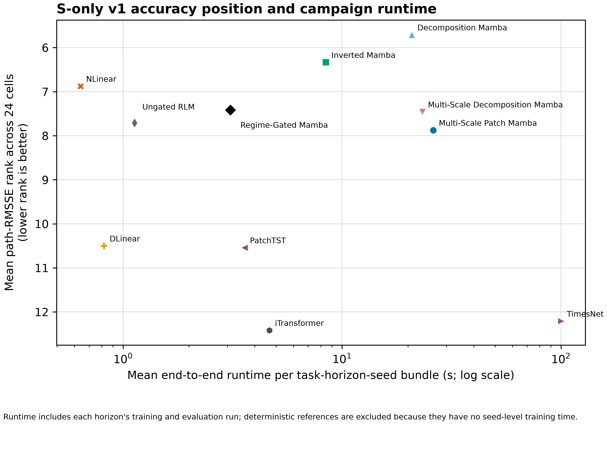
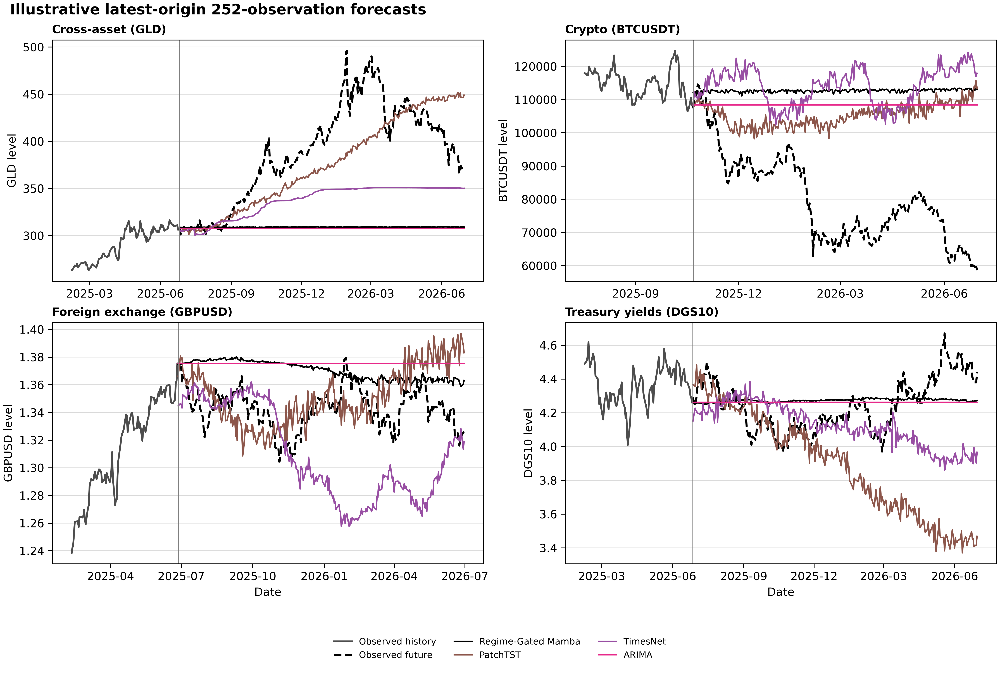

# Current Evaluation Record

Updated: 2026-08-14

## Evidence Status

`financial_s_only_v1` is a checksum-verified, retrospective four-panel release:

| Component | Completed | Planned |
| --- | ---: | ---: |
| Learned task-model-seed bundles | 220 | 220 |
| Learned task-model-seed-horizon rows | 1,320 | 1,320 |
| Deterministic task-model-horizon rows | 72 | 72 |
| Learned models | 11 | 11 |
| Deterministic references | 3 | 3 |

The verifier reports no missing artifacts or checksum problems in
[v1 release status](../reproducibility/financial_s_only_v1/release_status.json).
Each learned unit retains six checkpoints, forecasts, truth arrays, origin dates,
forecast dates, metadata, and recorded SHA-256 values in ignored local storage.

`financial_s_only_v2` is a separate 18-target data expansion. Its 324
deterministic rows are complete, but its 5,940 learned rows have not been run. It
is not included in any v1 rank, figure, or accuracy statement below.

## Protocol

- Input policy: one target channel (`S`) for every active task. No
  `financial_*_ms` input task is active.
- Training cutoff: 2020-12-31. Validation: 2021-01-01 through 2022-12-31.
  Retrospective evaluation: 2023-01-01 through 2026-06-30.
- Horizons: 1, 5, 20, 60, 120, and 252 retained observations.
- Learned seeds: 2023, 2024, 2025, 2026, and 2027.
- Primary metric: path RMSSE. Path MAE and RMSE are retained on the original
  target scale. Terminal metrics are secondary.

The authoritative inputs are the [v1 protocol](../reproducibility/financial_s_only_v1/protocol.json),
[data manifest](../reproducibility/financial_s_only_v1/training_datasets.json),
[per-seed metrics](../reproducibility/financial_s_only_v1/metrics/metrics_by_seed.csv),
and [aggregate metrics](../reproducibility/financial_s_only_v1/metrics/metrics_aggregate.csv).

## Whole-Matrix Position

The following summary gives each model equal weight in every one of the 24
task-horizon cells. Lower mean rank is better. Runtime is the mean end-to-end
training-plus-evaluation time for a learned task-horizon-seed bundle; it is not a
hardware-independent inference benchmark.

| Model | Mean path-RMSSE rank | Rank-1 cells | Top-3 cells | Mean runtime (s) |
| --- | ---: | ---: | ---: | ---: |
| ARIMA | 3.00 | 9 | 19 | - |
| Last-value | 3.38 | 4 | 15 | - |
| Random-walk-with-drift | 3.58 | 2 | 15 | - |
| Decomposition Mamba | 5.71 | 0 | 1 | 20.83 |
| Inverted Mamba | 6.33 | 0 | 2 | 8.43 |
| NLinear | 6.88 | 3 | 4 | 0.64 |
| Regime-Gated Mamba | 7.42 | 2 | 3 | 3.09 |
| Multi-Scale Decomposition Mamba | 7.46 | 0 | 0 | 23.28 |
| Ungated Regime-Linear Mamba | 7.71 | 1 | 4 | 1.13 |
| Multi-Scale Patch Mamba | 7.88 | 0 | 2 | 26.11 |
| DLinear | 10.50 | 1 | 3 | 0.82 |
| PatchTST | 10.54 | 2 | 2 | 3.58 |
| TimesNet | 12.21 | 0 | 2 | 100.28 |
| iTransformer | 12.42 | 0 | 0 | 4.65 |

Regime-Gated Mamba is therefore not an overall accuracy winner. It has a better
mean rank than PatchTST, TimesNet, and iTransformer on this specific release, but
the simple deterministic references and several other Mamba variants are stronger
overall. Its 3.09 s mean campaign bundle time is 13.7% below PatchTST's 3.58 s and
96.9% below TimesNet's 100.28 s; this does not establish a universal efficiency
claim.

## Where the Proposed Model Wins

| Group | Horizons | Mean Regime-Gated Mamba rank | Rank-1 cells |
| --- | --- | ---: | ---: |
| Short | 1, 5 | 7.62 | 0 / 8 |
| Middle | 20, 60 | 7.62 | 0 / 8 |
| Long | 120, 252 | 7.00 | 2 / 8 |

| Task | Mean Regime-Gated Mamba rank | Rank-1 cells |
| --- | ---: | ---: |
| Cross-asset GLD | 10.33 | 0 / 6 |
| Crypto BTCUSDT | 9.67 | 0 / 6 |
| Foreign exchange GBPUSD | 6.17 | 0 / 6 |
| Treasury yields DGS10 | 3.50 | 2 / 6 |

The only primary-metric wins are the DGS10 yield task at horizon 120 and 252.
At horizon 120, Regime-Gated Mamba has path MAE/RMSE/RMSSE of
0.2787 / 0.3695 / 6.6380, compared with 0.2841 / 0.3758 / 6.7515 for its
ungated ablation and 0.2841 / 0.3762 / 6.7596 for ARIMA. At horizon 252, its
values are 0.3302 / 0.4246 / 7.6295, compared with 0.3327 / 0.4262 / 7.6573
for the ablation and 0.3409 / 0.4375 / 7.8604 for ARIMA.

The gate lowers path RMSSE relative to the ungated ablation in 16 of 24 cells.
The paired block-bootstrap point differences favor the gate at every horizon, but
no comparison survives the prespecified Holm correction across the full
model-reference-horizon family (smallest adjusted p-value: 0.308). This is
evidence of a bounded ablation effect, not a stable general superiority claim.

## Regime-Gated Mamba Path Metrics

Each entry is the five-seed mean. MAE and RMSE are level-scale values and must not
be averaged across the four targets. RMSSE and rank are scale-normalized within a
task-horizon cell.

| Task | H | Path MAE | Path RMSE | Path RMSSE | Rank |
| --- | ---: | ---: | ---: | ---: | ---: |
| Cross-asset | 1 | 3.8778 | 6.2457 | 5.0910 | 10 |
| Cross-asset | 5 | 5.5538 | 8.9507 | 7.2958 | 10 |
| Cross-asset | 20 | 8.6217 | 13.7599 | 11.2159 | 9 |
| Cross-asset | 60 | 15.4904 | 23.7320 | 19.3443 | 10 |
| Cross-asset | 120 | 24.2711 | 35.9888 | 29.3350 | 12 |
| Cross-asset | 252 | 40.1810 | 56.9331 | 46.4070 | 11 |
| Crypto | 1 | 2239.9269 | 3148.4346 | 9.2340 | 12 |
| Crypto | 5 | 2808.8584 | 3953.7313 | 11.5958 | 10 |
| Crypto | 20 | 4297.3658 | 6126.8809 | 17.9694 | 10 |
| Crypto | 60 | 7044.2710 | 10078.3732 | 29.5586 | 9 |
| Crypto | 120 | 10525.5277 | 14474.7333 | 42.4526 | 9 |
| Crypto | 252 | 15932.8414 | 20645.2241 | 60.5499 | 8 |
| Foreign exchange | 1 | 0.0045 | 0.0059 | 0.6379 | 3 |
| Foreign exchange | 5 | 0.0075 | 0.0099 | 1.0734 | 6 |
| Foreign exchange | 20 | 0.0138 | 0.0178 | 1.9242 | 7 |
| Foreign exchange | 60 | 0.0239 | 0.0312 | 3.3781 | 7 |
| Foreign exchange | 120 | 0.0316 | 0.0424 | 4.5810 | 8 |
| Foreign exchange | 252 | 0.0373 | 0.0482 | 5.2087 | 6 |
| Treasury yields | 1 | 0.0463 | 0.0591 | 1.0622 | 5 |
| Treasury yields | 5 | 0.0750 | 0.0989 | 1.7775 | 5 |
| Treasury yields | 20 | 0.1353 | 0.1777 | 3.1920 | 4 |
| Treasury yields | 60 | 0.2264 | 0.2954 | 5.3075 | 5 |
| Treasury yields | 120 | 0.2787 | 0.3695 | 6.6380 | 1 |
| Treasury yields | 252 | 0.3302 | 0.4246 | 7.6295 | 1 |

## Uncertainty and Metric Boundaries

For truth `y`, prediction `y_hat`, and the training-window one-step scale
`s = mean((y_t - y_(t-1))^2)`, path RMSSE is `sqrt(mean((y-y_hat)^2) / s)`.
The release reports path and terminal MAE, RMSE, MSE, and RMSSE. Path RMSSE is the
primary ranking measure.

The paired contrast tables compare Regime-Gated Mamba with Last-value,
Random-walk-with-drift, ARIMA, and the ungated ablation using scale-normalized
loss. The interval procedure resamples the four task clusters, five seed clusters,
and circular moving forecast-origin blocks of length equal to the horizon. It uses
10,000 replicates, seed 20260812, and Holm adjustment across 24 contrasts. It is
descriptive because four related financial panels do not support broad population
inference.

See [paired contrasts](../reproducibility/financial_s_only_v1/metrics/paired_contrasts.csv)
and [paired block-bootstrap results](../reproducibility/financial_s_only_v1/metrics/paired_block_bootstrap.csv).

## Figures

The last display uses the latest available h252 origin and learned seed 2023. It
is an illustrative trajectory display only; every aggregate statement above comes
from all rolling origins and all five learned seeds. Figure inputs and descriptions
are recorded in [the figure manifest](figures/financial_s_only_v1_figure_manifest.json).

## Claim Boundary

This release supports retrospective, protocol-matched comparisons for the four
named target series only. It does not support prospective forecasting claims,
trading-value claims, economic-causality claims, general financial-market claims,
or an unqualified statement that Regime-Gated Mamba is more accurate than all
baselines.
