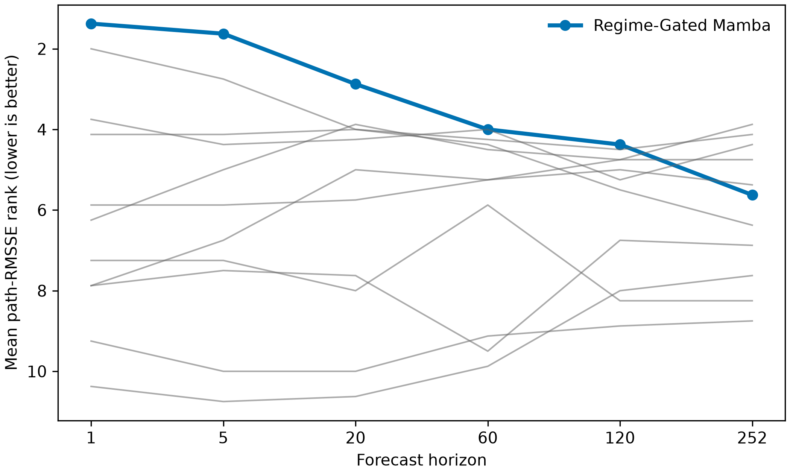
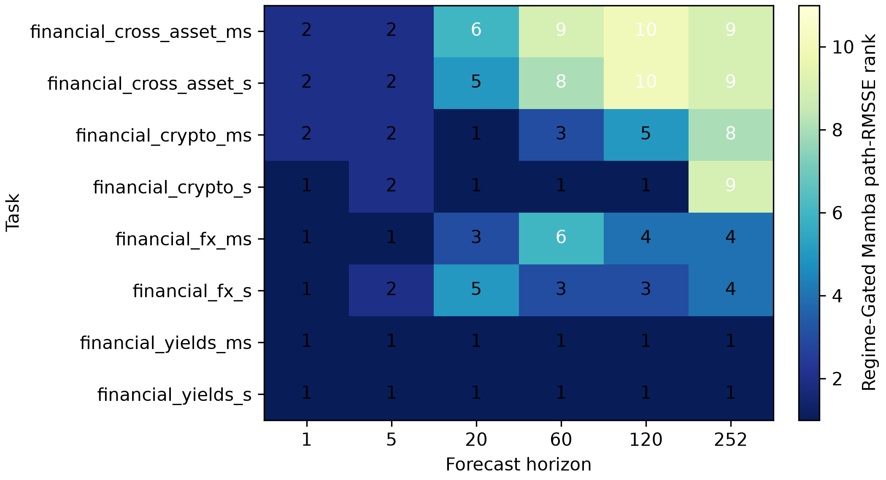
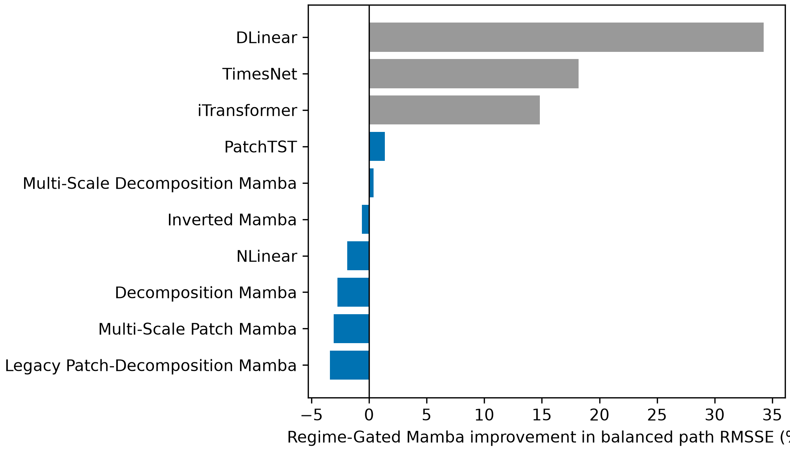

# Evaluation Record

Updated: 2026-08-09

This is a completed retrospective, protocol-matched evaluation on the four financial
reference panels. The 2023-2026 target period had already been opened by the earlier
baseline suite, so these results are not an untouched prospective test. The selected
Regime-Gated Mamba configuration was fixed using the separate 2022 merge gate before
this comparison. This evidence supports descriptive model comparison only.

## Evaluation coverage

Eight tasks, six horizons, and five seeds were evaluated. The canonical metric table
contains 2,640 rows: 480 selected-model/ablation rows and 2,160 audited-baseline rows.
The primary ranking metric is path RMSSE. MAE, MSE, RMSE, terminal-point metrics,
runtime, and peak memory are preserved in
[`all_model_aggregate_metrics.csv`](../reproducibility/financial_reference_evaluation_v1/metrics/all_model_aggregate_metrics.csv).

Regime-Gated Mamba had the lowest path RMSSE in 20 of 48 task-horizon cells and a
mean rank of 3.31 across all cells. The rank profile is horizon dependent:

| Horizon | Mean path-RMSSE rank | Interpretation |
| ---: | ---: | --- |
| 1 | 1.38 | Strongest position. |
| 5 | 1.63 | Strong position. |
| 20 | 2.88 | Competitive. |
| 60 | 4.00 | Middle of the comparison set. |
| 120 | 4.38 | Below the leading long-horizon models. |
| 252 | 5.63 | Weakest relative position. |

The figures use lower ranks as better. They show that the selected model's evidence is
short-horizon accuracy and computational efficiency, not a general claim of superiority
at long horizons.

## Merge-gate comparison

The 2022 merge gate was used to select the proposed configuration. Its balanced path
RMSSE summary is retained as a selection record, not mixed with the retrospective
evaluation above.

| Model | Cross-asset | Cryptoasset | Foreign exchange | Treasury yields |
| --- | ---: | ---: | ---: | ---: |
| Regime-Gated Mamba | 1.5993 | 5.3724 | 11.0567 | 6.0095 |
| Multi-Scale Patch Mamba | 1.8890 | 5.5702 | 11.3262 | 6.4778 |
| Decomposition Mamba | 1.9208 | 5.6919 | 11.7857 | 6.8692 |

The selection snapshot files are stored under
`reproducibility/financial_reference_evaluation_v1/candidate_selection/`.

## Uncertainty summary and limitations

Nested task-then-seed bootstrap contrasts use 10,000 replicates. Their intervals are
descriptive because the `S` and `MS` views of each panel overlap and should not be
treated as independent datasets.

The model is not the best-performing system for every task or horizon. In particular,
PatchTST and TimesNet are stronger comparators at the longest horizons in parts of the
reference suite. Financial levels, a small number of overlapping panels, and a
retrospective evaluation boundary limit generalization claims and rule out trading or
economic-inference claims.

All per-seed metrics, source identifiers, and generated summary inputs are located in
[`reproducibility/financial_reference_evaluation_v1/metrics`](../reproducibility/financial_reference_evaluation_v1/metrics).
