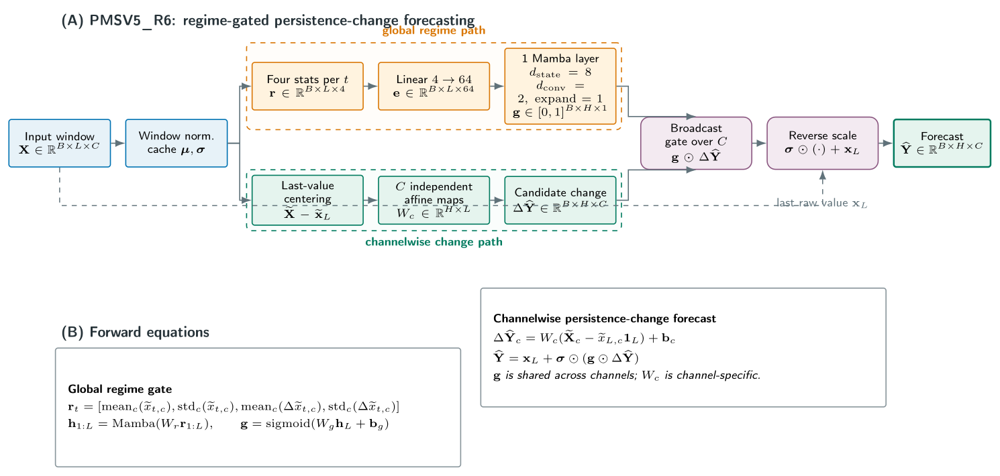

# PMSV5_R6: Model Architecture and Evaluation Evidence

Updated: 2026-08-09

## What This Document Establishes

`PMSV5_R6` is the selected PMS-Mamba configuration. On the locked 2022 financial
merge gate, it has lower balanced RMSSE than its two required Mamba references:
`PMSV3_B0` and retuned `NS-Mamba-D`. Its direct accuracy comparison with PatchTST,
TimesNet, statistical baselines, and horizon 252 on the untouched 2023-2026 financial
period has not been run. This distinction is the central evidence boundary for the
paper.

| Evidence layer | PMS configuration | Time period | Permitted use |
| --- | --- | --- | --- |
| Development selection | R6 and other candidates | 2021 | Architecture selection |
| Locked merge gate | PMSV5_R6 | 2022 | Current promotion result |
| Historical common suite | Earlier PMS-Mamba-PD | Frozen prior benchmark | Context only |
| Final financial test | PMSV5_R6 | 2023-2026 | Not yet opened |

## PMSV5_R6 Architecture



**Figure 1.** PMSV5_R6 uses a single global Mamba regime path and a separate
channel-specific affine change path. The global gate is broadcast across channels,
while every channel has its own history-to-horizon map. The forecast is anchored at the
last raw observation, not at a separately predicted level.

Publication assets: [editable TikZ source](../manuscript/figures/pmsv5_r6_architecture.tex),
[vector PDF](figures/pmsv5_r6_architecture_tikz.pdf), and
[RGB preview](figures/pmsv5_r6_architecture_tikz_rgb.png).

### Tensor Contract and Forward Pass

The model receives a batch of windows
`X in R^(B x L x C)` and returns a forecast path
`Y_hat in R^(B x H x C)`, where `B` is batch size, `L` is the observed history length,
`H` is the forecast horizon, and `C` is the number of target channels.

1. **Window normalization.** The model computes a per-window mean and standard
   deviation across time, then forms the normalized input `X_tilde`. The standard
   deviation is retained so a predicted change can be restored to raw scale.
2. **Global regime sequence.** At each time step, it computes the cross-channel mean
   and standard deviation of levels and first differences. This produces four features
   per step, with shape `B x L x 4`.
3. **Mamba gate.** A linear projection maps the four features to `d_model=64`. One
   Mamba block (`d_state=8`, `d_conv=2`, `expand=1`) is applied with a residual
   connection and LayerNorm. The final representation is mapped through a sigmoid to a
   horizon gate with shape `B x H x 1`.
4. **Channel-specific change path.** The last normalized value is removed from each
   channel history. Each channel then applies its own affine `L -> H` map, producing
   `Delta Y_hat` with shape `B x H x C`.
5. **Persistence-change forecast.** The horizon gate is broadcast across channels,
   multiplied by the candidate change, restored with the cached standard deviation, and
   added to the last raw observation.

In compact notation:

```text
r_t = [mean_c(X_tilde[t,c]), std_c(X_tilde[t,c]),
       mean_c(Delta X_tilde[t,c]), std_c(Delta X_tilde[t,c])]
h_1:L = LayerNorm(E(r_1:L) + Mamba(E(r_1:L)))
g = sigmoid(W_g h_L + b_g)
Delta Y_hat_c = W_c (X_tilde_c - x_tilde_L,c) + b_c
Y_hat = x_L + sigma * (g * Delta Y_hat)
```

The architecture deliberately excludes decomposition, multiscale patch branches, and
the previous per-channel neural gate. These exclusions are part of the selected R6
configuration, not omitted parts of the diagram.

### Frozen Configuration

| Component | Selected R6 setting | Consequence |
| --- | --- | --- |
| Branch mode | `regime_linear` | One global regime path plus channelwise linear changes |
| Regime width | `d_model=64` | Compact global representation |
| Mamba state | `d_state=8`, `d_conv=2`, `expand=1` | Small selective state-space block |
| Mamba depth | `e_layers=1` | One temporal regime scan |
| Forecast head | `persistence_change` | Predicts a change around the last value |
| Channel forecast | `pms_regime_individual_linear=1` | Separate affine map for each channel |
| Per-channel neural gate | `pms_regime_channel_gate=0` | No additional neural channel gate |
| Decomposition | `ms_use_decomp=0` | No trend, seasonal, or residual branch |
| Multiscale patching | Disabled by `regime_linear` | No patch hierarchy |
| Training loss | MSE | Optimization loss, not the promotion objective |

Implementation: `model/PMS_Mamba.py`, method `_regime_linear_forecast`.
Frozen candidate recipe: `configs/pms_mamba_v3.json`, `v5_candidates.PMSV5_R6`.

## Metrics and Decision Rule

Let `e = forecast - observation` over all scored forecast values.

| Metric | Interpretation | Role in this project |
| --- | --- | --- |
| MAE | Mean absolute error in target units | Report within a dataset or target only |
| MSE | Mean squared error | Training loss for R6 |
| RMSE | Square root of MSE, in target units | Reports sensitivity to larger errors within a target |
| MAPE and MSPE | Percentage errors | Diagnostic only; unstable near zero |
| Path RMSSE | RMSE scaled by one-step training differences | Primary scale-free accuracy metric |
| Terminal RMSSE | RMSSE at the final horizon step | Long-horizon diagnostic |
| Balanced RMSSE | Equal mean of short, middle, and long path-RMSSE groups | Merge-gate promotion objective |

The RMSSE denominator is computed separately for each channel from one-step
differences in the training series, with a numerical floor. This permits a scale-free
comparison across cross-asset, crypto, FX, and yield tasks. Raw MAE and RMSE should not
be averaged across those targets as if they had a common unit.

For the R6 merge gate, short horizons are 1 and 5, middle horizons are 20 and 60, and
the long group contains horizon 120. Horizon 252 is intentionally excluded because a
single 2022 validation year does not contain enough complete financial observations for
that horizon. Path metrics score every available step of the forecast trajectory;
terminal metrics score the final step only.

## Current Locked Merge-Gate Result

The completed gate contains eight financial tasks, five selected horizons, five seeds,
and three configurations: 600 completed metric rows. Lower values are better.

| Configuration | Short RMSSE | Middle RMSSE | Long RMSSE | Balanced RMSSE |
| --- | ---: | ---: | ---: | ---: |
| PMSV5_R6 | **1.5993** | **5.3724** | **11.0567** | **6.0095** |
| PMSV3_B0 | 1.8890 | 6.1731 | 13.1483 | 7.0701 |
| Retuned NS-Mamba-D | 1.9208 | 6.5225 | 13.5159 | 7.3197 |

R6 improves balanced RMSSE by 15.00% relative to B0 and 17.90% relative to retuned
NS-Mamba-D. It improves every merge-gate horizon group against both references.

| Task | R6 balanced RMSSE | B0 | Retuned NS-Mamba-D | R6 result |
| --- | ---: | ---: | ---: | --- |
| Cross-asset MS | **5.4958** | 6.2245 | 6.2293 | Best |
| Cross-asset S | **5.5327** | 6.1924 | 6.2290 | Best |
| Crypto MS | **5.5152** | 8.8209 | 9.4265 | Best |
| Crypto S | **5.8704** | 9.3165 | 8.9998 | Best |
| FX MS | 5.1721 | **4.7027** | 5.6307 | Second to B0 |
| FX S | 4.9429 | **4.7196** | 5.4109 | Second to B0 |
| Yields MS | **7.7785** | 8.2933 | 8.2467 | Best |
| Yields S | **7.7684** | 8.2911 | 8.3850 | Best |

The task pattern is descriptive: R6 wins six of eight tasks against B0 and all eight
against the retuned NS-Mamba-D reference, while B0 remains better on both FX tasks. It
does not establish why the effect occurs or whether it will persist on the final test.

## Matched Inference Profile

The profile uses float32 CUDA forward passes at batch size 32, with 20 warm-up and 100
measured iterations across 40 task-horizon cells per model.

| Model | Profiled cells | Median latency (ms) | Median peak allocated memory (MB) |
| --- | ---: | ---: | ---: |
| PMSV5_R6 | 40 | **0.263** | **14.2** |
| PatchTST | 40 | 0.399 | 26.7 |
| TimesNet | 40 | 12.120 | 159.7 |

Under this recorded protocol, PatchTST has 1.52 times R6's median latency and TimesNet
has 46.10 times R6's median latency. The same profile shows lower allocated memory for
R6. It supports an implementation-level forward-pass latency and allocated-memory
claim only; it does not establish training cost, CPU performance, energy use, or
asymptotic complexity.

The stored R6 throughput field is internally inconsistent, and the R6 `seq_len` field
is blank in the consolidated profile. Do not cite throughput. Regenerate this profile
with uniform hardware and software metadata before paper submission.

## Historical Benchmark Context

The historical common metric suite evaluates **earlier PMS-Mamba-PD**, not R6. It is
useful context for the earlier architecture but cannot answer whether R6 beats PatchTST,
TimesNet, or persistence baselines.

| Historical model | Mean path MAE | Mean path RMSE | Mean path RMSSE | Mean RMSSE rank |
| --- | ---: | ---: | ---: | ---: |
| Random-walk drift | 1,602.61 | 2,242.91 | **12.6767** | **3.02** |
| Earlier PMS-Mamba-PD | 1,673.41 | 2,300.09 | 12.9669 | 6.63 |
| Last-value | 1,629.22 | 2,253.62 | 13.0323 | 3.19 |
| NS-Mamba-D | 1,646.36 | 2,273.29 | 13.0514 | 5.96 |
| PatchTST | 1,809.37 | 2,434.28 | 13.5955 | 9.35 |
| TimesNet | 2,366.12 | 3,133.72 | 16.3875 | 10.92 |

Earlier PMS-Mamba-PD has a lower aggregate path RMSSE than PatchTST and TimesNet in
this suite, but it has no individual path-RMSSE cell wins and a worse mean rank than
the naive references. Random-walk drift has the strongest aggregate RMSSE in the
subset shown. These results support historical context, not a claim about R6.

The full historical architecture plate is therefore supplementary only:
[TikZ source](../manuscript/figures/all_model_architecture_gallery.tex),
[vector PDF](figures/all_model_architecture_gallery_tikz.pdf), and
[PNG preview](figures/all_model_architecture_gallery_tikz_rgb.png).

## Claims the Current Evidence Supports

The strongest defensible result statement is:

> On the locked 2022 financial merge gate, PMSV5_R6 achieved lower balanced RMSSE than
> PMSV3_B0 and retuned NS-Mamba-D, while using lower matched CUDA forward-pass latency
> and allocated memory than PatchTST and TimesNet under the recorded profiling protocol.

The evidence does **not** yet support a claim that R6 is more accurate than PatchTST,
TimesNet, random-walk drift, or other baselines on the untouched 2023-2026 financial
test. That comparison must include the final protocol, horizon 252, and uncertainty
across the planned seeds.

## Evidence Artifacts

| Evidence | Repository artifact |
| --- | --- |
| R6 implementation | `model/PMS_Mamba.py` |
| Frozen R6 candidate and horizon protocol | `configs/pms_mamba_v3.json` |
| Gate decision and improvement thresholds | `results/nonstationary_analysis_v5/gate/promotion_decision.json` |
| Gate aggregates | `results/nonstationary_analysis_v5/gate/config_summary.csv` |
| Gate task and seed records | `results/nonstationary_analysis_v5/gate/run_summary.csv` |
| Matched inference profile | `results/nonstationary_analysis_v5/profile/matched_inference_profile.csv` |
| Historical all-model summary | `results/nonstationary_metric_suite/model_common_metric_summary.csv` |
