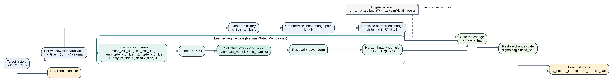

# Model Reference

## Active Proposed Model

The active proposed model is `RegimeGatedMamba`, displayed as **Regime-Gated
Mamba**. Its active recipe is the `regime_linear` branch in
[`model/RegimeGatedMamba.py`](../model/RegimeGatedMamba.py), not the file's optional
patch, decomposition, or multiscale branches.

The source figure is
[`regime_gated_mamba_s_only.dot`](figures/regime_gated_mamba_s_only.dot), with SVG
and PDF versions beside it for manuscript preparation.

For a target window `x` of length `L` and a forecast horizon `H`, the active branch:

1. standardizes each input window using its own temporal mean and standard deviation;
2. centers the standardized history on its final observation;
3. sends that centered single-channel history through a channelwise linear map from
   `L` to `H`, giving a normalized change path;
4. derives four timewise summaries and passes them through a 4-to-64 projection, one
   Mamba block (`d_state=8`), residual LayerNorm, and an `H`-output sigmoid head;
5. multiplies the predicted change path by the horizon-wise gate, restores the
   temporal scale, and adds the last observed level as a persistence anchor.

Thus the active forecast is `x_L + sigma * (g * delta_hat)`. It does **not** use
moving-average decomposition, temporal patch encoding, bidirectional patch Mamba, or
the generic `persistence_change` head in the active proposed configuration.

With exactly one target channel, the two cross-channel standard-deviation summary
features are identically zero. This is a known implementation limitation, not a
claimed nonstationarity mechanism. A redesign using non-degenerate temporal features
would require a new model identifier and a new release; it must not be silently
combined with this architecture.

## Ablation

`UngatedRegimeLinearMamba` retains normalization, the same channelwise linear
change path, and the same persistence anchor, but fixes `g=1`. It does not instantiate
the gate projection, Mamba block, normalization, or horizon head. The ablation
therefore tests whether the learned gate contributes beyond the linear persistence
forecast while exposing its true parameter and latency cost.

`LastValue` is the persistence-only reference. Together these form the pre-specified
ablation sequence: persistence anchor, ungated linear change, then full learned gate.

## Comparison Roster

Both releases use 11 learned models and three deterministic references:

| ID | Display name | Role |
| --- | --- | --- |
| `RegimeGatedMamba` | Regime-Gated Mamba | Proposed model |
| `UngatedRegimeLinearMamba` | Ungated Regime-Linear Mamba | Gate ablation |
| `MultiScalePatchMamba` | Multi-Scale Patch Mamba | Architectural ablation |
| `InvertedMamba` | Inverted Mamba | Mamba baseline |
| `DecompositionMamba` | Decomposition Mamba | Mamba baseline |
| `MultiScaleDecompositionMamba` | Multi-Scale Decomposition Mamba | Mamba baseline |
| `DLinear` | DLinear | Learned baseline |
| `NLinear` | NLinear | Learned baseline |
| `PatchTST` | PatchTST | Learned baseline |
| `TimesNet` | TimesNet | Learned baseline |
| `iTransformer` | iTransformer | Learned baseline |
| `LastValue` | Last-value | Deterministic reference |
| `RandomWalkDrift` | Random-walk-with-drift | Deterministic reference |
| `ARIMA` | ARIMA | Deterministic reference |

The source implementation names are retained only as `source_model_id` in each
release's `model_identity_map.json`. The current public identifiers above are the
only names used in active commands and documentation.

## Frozen Training Recipe

The active v1/v2 configurations set `d_model=64`, `d_ff=128`, `d_state=8`, one
layer, MSE training loss, and balanced horizon weighting. Frozen family-level
parameter selections were made using data through 2022 and are copied into each
release under `selection/`. Their study names preserve historical provenance but do
not imply that the old mixed-protocol release is active.
