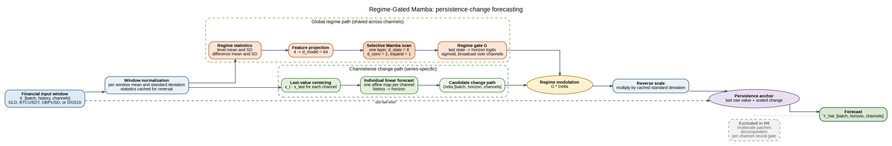

# Model Reference

## Regime-Gated Mamba

Regime-Gated Mamba is the selected state-space forecaster. Its design preserves the
efficient sequence processing of Mamba while making the prediction head sensitive to
the recent level and estimated change regime. The implementation is
[`model/RegimeGatedMamba.py`](../model/RegimeGatedMamba.py).

For an input tensor `x` with shape `[batch, input_length, variables]`, the active
recipe applies reversible normalization, moving-average decomposition, and temporal
patch encoding. Bidirectional state-space encoders process the patch sequence. The
selected `regime_linear` branch predicts a gated change around the last observed
level, then restores the original scale. The output has shape
`[batch, forecast_horizon, target_variables]`.

The architecture figure is generated from
[`figures/regime_gated_mamba_architecture.dot`](figures/regime_gated_mamba_architecture.dot)
and is provided as PNG, PDF, and SVG for technical reuse.

## Compared models

| Canonical ID | Name | Implementation | Role |
| --- | --- | --- | --- |
| `RegimeGatedMamba` | Regime-Gated Mamba | `model/RegimeGatedMamba.py` | Selected proposed model. |
| `MultiScalePatchMamba` | Multi-Scale Patch Mamba | `model/MultiScalePatchMamba.py` | Level-head, multi-scale ablation. |
| `InvertedMamba` | Inverted Mamba | `model/InvertedMamba.py` | Variable-token Mamba baseline. |
| `DecompositionMamba` | Decomposition Mamba | `model/DecompositionMamba.py` | Additive-decomposition Mamba baseline. |
| `MultiScaleDecompositionMamba` | Multi-Scale Decomposition Mamba | `model/MultiScaleDecompositionMamba.py` | Multi-scale decomposition Mamba baseline. |
| `PatchTST` | PatchTST | `model/PatchTST.py` | Patch-based Transformer baseline. |
| `TimesNet` | TimesNet | `model/TimesNet.py` | Periodicity-aware baseline. |
| `DLinear`, `NLinear`, `iTransformer` | Unchanged | `model/` | Additional audited baselines. |

Historical evaluation records retain the original run identifier in `source_model_id`.
The mapping is frozen in
[`model_identity_map.json`](../reproducibility/financial_reference_evaluation_v1/model_identity_map.json).
It is provenance only: commands, configuration keys, documentation, and reader-facing
results use the canonical identifiers above.

## Frozen selected recipe

The selected recipe is defined in
[`financial_reference_evaluation_v1.json`](../configs/financial_reference_evaluation_v1.json):
`d_model=64`, `d_ff=128`, `d_state=8`, one encoder layer, reversible normalization,
the `regime_linear` branch, and the persistence-change forecast head. Its comparison
uses common task splits, seeds, horizons, and selection snapshots.

The selected design is efficient and competitive, rather than universally dominant.
Its evaluation position, including its long-horizon limitation, is reported in
[evaluation_record.md](evaluation_record.md).
