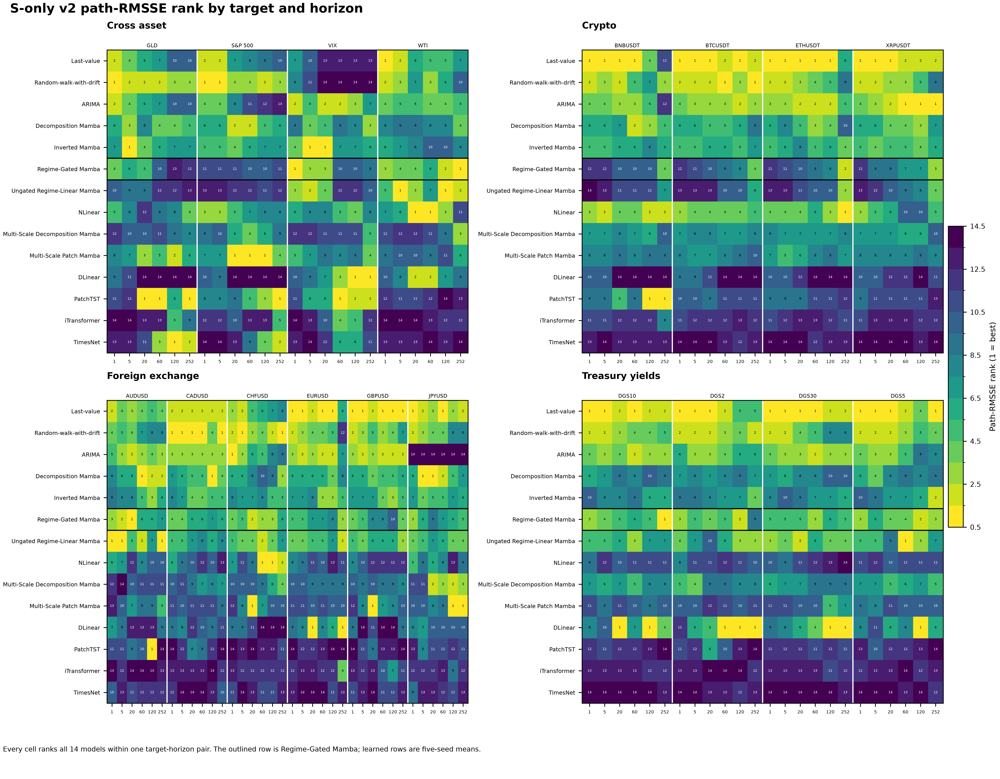
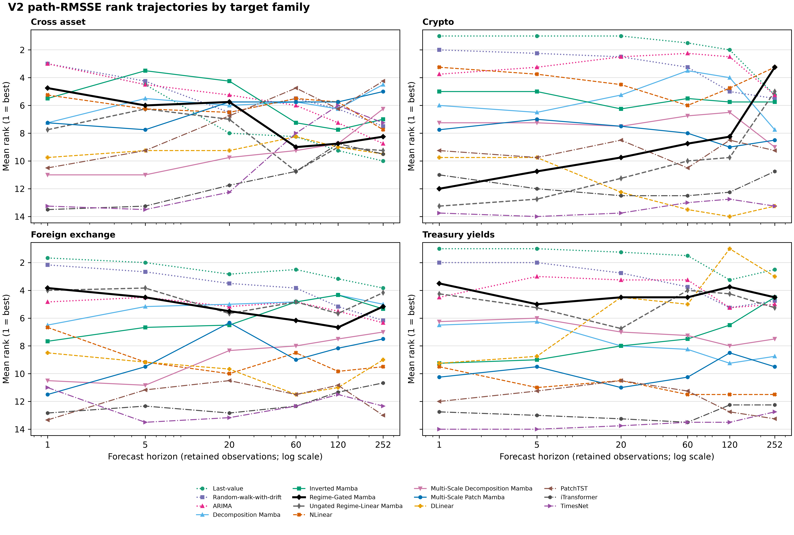
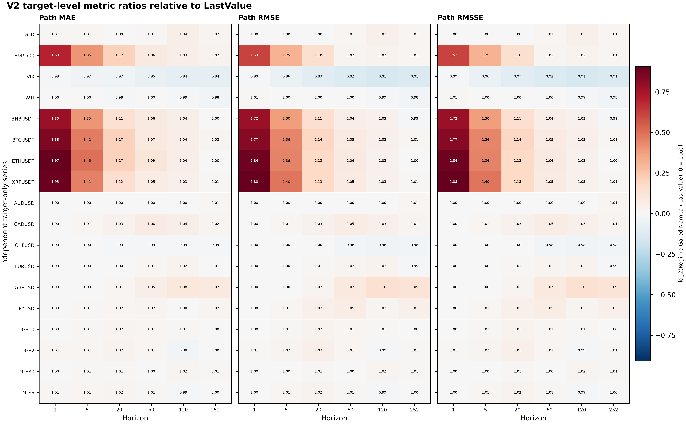
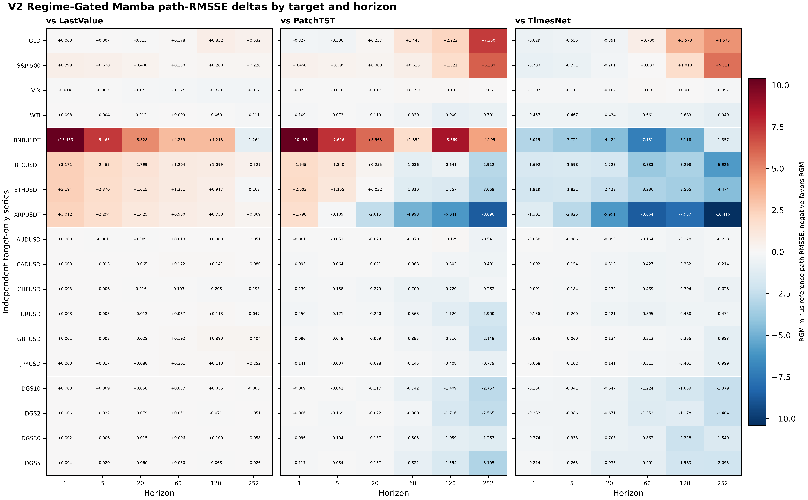
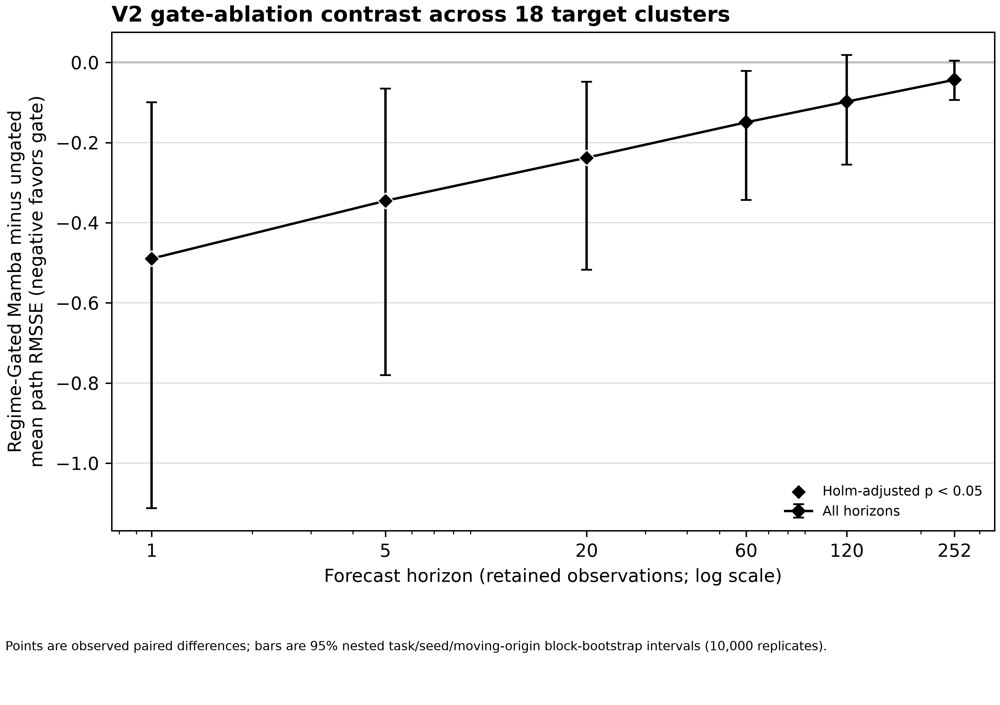
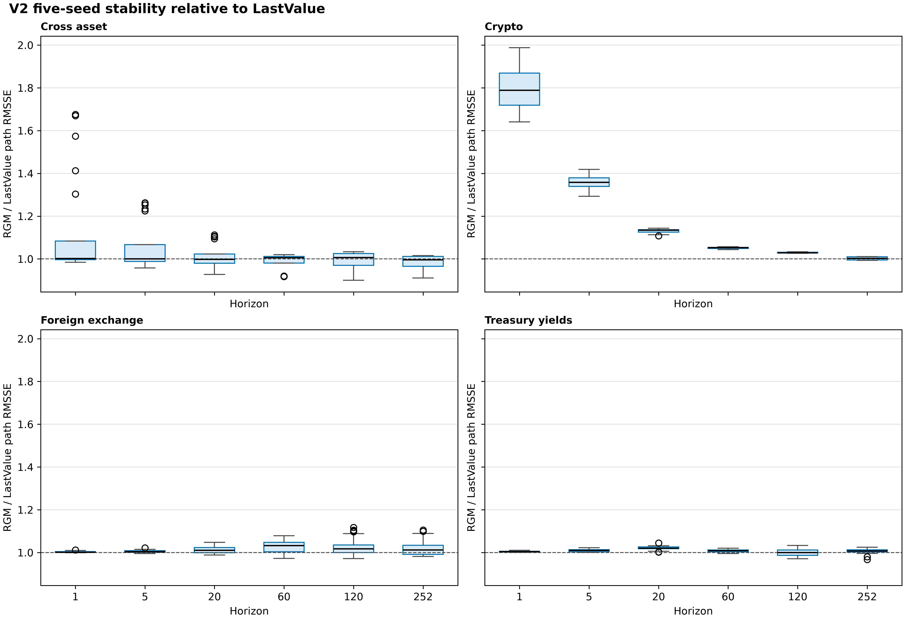
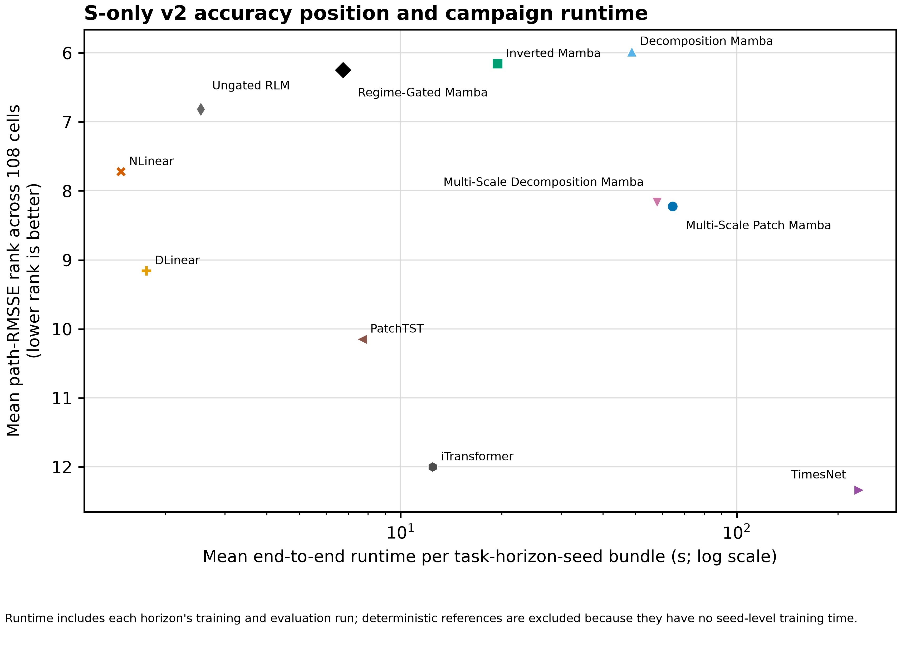

# V2 Results Analysis

## Executive Finding

The completed `financial_s_only_v2` release provides a broad, reproducible
target-only benchmark, but it does not show universal accuracy superiority for
Regime-Gated Mamba. The proposed model occupies a middle position overall and its
behavior is strongly dependent on target family and horizon.

The defensible result is a bounded accuracy/runtime tradeoff: the gate improves
the matched ungated model with Holm-corrected evidence through horizons 1, 5, and
20, while the model is strongest in Treasury yields and foreign exchange, weak in
crypto at short horizons, and faster than PatchTST and TimesNet in the recorded
campaign.

## Scope And Completion

| Evidence component | Completed | Expected |
| --- | ---: | ---: |
| Target-only learned task-model-seed-horizon rows | 5,940 | 5,940 |
| Deterministic task-model-horizon rows | 324 | 324 |
| Retained learned checkpoints | 5,940 | 5,940 |
| Target-horizon cells | 108 | 108 |

The [release status](../reproducibility/financial_s_only_v2/release_status.json)
is `verified` with an empty `problems` list. The evaluation is retrospective over
2023-01-01 through 2026-06-30. The test interval was previously viewed and must
not be described as prospective or untouched.

The 18 independently materialized targets are:

| Family | Targets | Cells |
| --- | --- | ---: |
| Cross asset | GLD, S&P 500, VIX, WTI | 24 |
| Crypto | BNBUSDT, BTCUSDT, ETHUSDT, XRPUSDT | 24 |
| Foreign exchange | AUDUSD, CADUSD, CHFUSD, EURUSD, GBPUSD, JPYUSD | 36 |
| Treasury yields | DGS2, DGS5, DGS10, DGS30 | 24 |

“Independent” means one date-plus-target file per series; it does not assert
statistical independence between financial markets. See
[data_reference.md](data_reference.md) for ranges, row counts, split boundaries,
and source hashes.

## Metric Protocol

Path RMSSE is the primary cross-target ranking metric. Every model is ranked within
each target-horizon cell, with rank 1 indicating the lowest path RMSSE. The 108
cells have equal weight in the aggregate rank tables.

Path MAE and path RMSE are retained on the original target scale. They are shown
per target and horizon and are not averaged across GLD, crypto, FX, and yield
levels. When a cross-target metric comparison is needed, this report uses an
explicit ratio such as `Regime-Gated Mamba / LastValue`; a ratio below 1 favors
Regime-Gated Mamba.

Terminal metrics remain available in the release tables but are secondary because
the protocol evaluates the complete forecast path.

## Complete Model Comparison

| Model | Mean path-RMSSE rank | Rank-1 cells | Top-three cells | Mean runtime (s) |
| --- | ---: | ---: | ---: | ---: |
| Last-value | 3.31 | 42 | 74 | -- |
| Random-walk-with-drift | 4.05 | 12 | 63 | -- |
| ARIMA | 4.64 | 4 | 58 | -- |
| Decomposition Mamba | 5.98 | 4 | 16 | 48.67 |
| Inverted Mamba | 6.16 | 3 | 8 | 19.43 |
| Regime-Gated Mamba | 6.25 | 4 | 24 | 6.74 |
| Ungated Regime-Linear Mamba | 6.81 | 6 | 21 | 2.54 |
| NLinear | 7.72 | 5 | 16 | 1.47 |
| Multi-Scale Decomposition Mamba | 8.17 | 0 | 5 | 57.91 |
| Multi-Scale Patch Mamba | 8.22 | 7 | 9 | 64.40 |
| DLinear | 9.16 | 12 | 15 | 1.75 |
| PatchTST | 10.15 | 8 | 11 | 7.67 |
| iTransformer | 12.00 | 0 | 0 | 12.44 |
| TimesNet | 12.33 | 1 | 4 | 231.16 |

Regime-Gated Mamba is not the overall winner. LastValue, RandomWalkDrift, ARIMA,
and two Mamba baselines have better mean ranks. The proposed model is nevertheless
better positioned than PatchTST, iTransformer, and TimesNet in this release, and
it improves the matched ungated ablation in strict path-RMSSE wins.

The machine-readable versions of this table are
[model_summary.csv](analysis/financial_s_only_v2/model_summary.csv),
[horizon_summary.csv](analysis/financial_s_only_v2/horizon_summary.csv), and
[family_summary.csv](analysis/financial_s_only_v2/family_summary.csv).

## Regime-Gated Mamba By Horizon

| Horizon | Mean rank | Rank-1 cells | Top-three cells |
| ---: | ---: | ---: | ---: |
| 1 | 5.78 | 1 | 7 |
| 5 | 6.33 | 0 | 2 |
| 20 | 6.28 | 1 | 3 |
| 60 | 7.00 | 0 | 2 |
| 120 | 6.83 | 0 | 4 |
| 252 | 5.28 | 2 | 6 |

The model is not simply a short-horizon or long-horizon specialist. Its worst
aggregate position is h60, while h252 is its best position because it wins WTI and
DGS10 cells and remains competitive in several other targets. These are
descriptive rank patterns, not evidence that horizon alone causes the difference.

## Regime-Gated Mamba By Family

| Family | Mean rank | Rank-1 cells | Top-three cells |
| --- | ---: | ---: | ---: |
| Treasury yields | 4.29 | 1 | 8 |
| Foreign exchange | 5.31 | 1 | 8 |
| Cross asset | 7.08 | 2 | 6 |
| Crypto | 8.79 | 0 | 2 |

The target-level summary shows where this pattern comes from:

| Target | Mean rank | Rank-1 | Top 3 | Mean RMSSE / LastValue |
| --- | ---: | ---: | ---: | ---: |
| WTI | 3.33 | 1 | 3 | 1.00 |
| VIX | 6.00 | 1 | 3 | 0.94 |
| GLD | 8.33 | 0 | 0 | 1.01 |
| S&P 500 | 10.67 | 0 | 0 | 1.15 |
| XRPUSDT | 7.83 | 0 | 1 | 1.25 |
| ETHUSDT | 8.67 | 0 | 1 | 1.24 |
| BTCUSDT | 9.00 | 0 | 0 | 1.23 |
| BNBUSDT | 9.67 | 0 | 0 | 1.20 |
| CHFUSD | 3.83 | 0 | 3 | 0.99 |
| AUDUSD | 4.17 | 1 | 3 | 1.00 |
| CADUSD | 5.50 | 0 | 0 | 1.02 |
| EURUSD | 5.83 | 0 | 1 | 1.01 |
| JPYUSD | 6.00 | 0 | 1 | 1.02 |
| GBPUSD | 6.50 | 0 | 0 | 1.05 |
| DGS5 | 3.67 | 0 | 3 | 1.01 |
| DGS10 | 4.00 | 1 | 2 | 1.01 |
| DGS2 | 4.67 | 0 | 2 | 1.01 |
| DGS30 | 4.83 | 0 | 1 | 1.01 |

The ratio column is a target-scale-normalized summary, not a replacement for the
raw MAE/RMSE values. Full raw cell values, all reference deltas, and all 108 cells
are in [target_summary.csv](analysis/financial_s_only_v2/target_summary.csv) and
[regime_gated_cell_metrics.csv](analysis/financial_s_only_v2/regime_gated_cell_metrics.csv).

The metric pattern is consistent: S&P 500 and crypto have materially larger
short-horizon ratios than LastValue, while FX and yields are usually close to 1.
This suggests that the current model behaves as a persistence-oriented level
forecaster and may not adapt quickly enough to abrupt equity or crypto movements.
That is a hypothesis for follow-up work, not a causal conclusion from this release.

## Pairwise Comparisons

The following strict counts compare the five-seed mean path RMSSE in the same 108
cells. Negative mean delta favors Regime-Gated Mamba.

| Reference | RGM wins | RGM losses | Mean RGM minus reference RMSSE |
| --- | ---: | ---: | ---: |
| LastValue | 22 | 86 | +0.6467 |
| RandomWalkDrift | 30 | 78 | +0.7711 |
| ARIMA | 35 | 73 | -3.2965 |
| Ungated Regime-Linear Mamba | 71 | 37 | -0.2272 |
| PatchTST | 81 | 27 | +0.0071 |
| TimesNet | 100 | 8 | -1.1492 |
| iTransformer | 96 | 12 | -0.7987 |

The PatchTST difference is close to zero despite 81 strict cell wins, so the
appropriate conclusion is parity with heterogeneous cell-level behavior, not a
global PatchTST superiority claim. The deterministic references remain stronger
overall, especially in crypto and several short-horizon cells.

## Gate Ablation

The matched comparison is `Regime-Gated Mamba` versus
`Ungated Regime-Linear Mamba`. The paired bootstrap resamples target clusters,
seed clusters, and circular moving-origin blocks with 10,000 replicates. Negative
values favor the gate.

| Horizon | Mean difference | 95% bootstrap interval | Holm-adjusted p |
| ---: | ---: | ---: | ---: |
| 1 | -0.4895 | [-1.1123, -0.0993] | 0.0000 |
| 5 | -0.3453 | [-0.7803, -0.0652] | 0.0190 |
| 20 | -0.2377 | [-0.5172, -0.0484] | 0.0046 |
| 60 | -0.1494 | [-0.3433, -0.0214] | 0.1032 |
| 120 | -0.0978 | [-0.2550, 0.0188] | 1.0000 |
| 252 | -0.0433 | [-0.0940, 0.0043] | 0.7200 |

The corrected gate effect is supported through h20 only. The point estimates remain
negative at longer horizons, but their corrected intervals do not establish a
release-wide advantage there.

## Seed Stability

Each learned cell has five seeds. The median cell-level coefficient of variation
for Regime-Gated Mamba path RMSSE is 0.0038, but the range is approximately
0.00004 to 0.1075. The largest dispersion is concentrated in short-horizon crypto
cells, where the model is also weakest relative to LastValue. FX and yield cells
are generally much tighter.

The complete seed-level stability table is
[seed_stability.csv](analysis/financial_s_only_v2/seed_stability.csv). Seed
variation should be reported alongside mean metrics; it should not be interpreted
as an independent replication of the retrospective test interval.

## Runtime And Efficiency

The observed end-to-end campaign runtime includes training and evaluation for one
task-horizon-seed bundle:

| Model | Mean seconds per bundle |
| --- | ---: |
| Regime-Gated Mamba | 6.74 |
| PatchTST | 7.67 |
| TimesNet | 231.16 |
| iTransformer | 12.44 |

Regime-Gated Mamba is 12.2% faster than PatchTST and 97.1% faster than TimesNet in
this measured recipe. The fixed GLD forward profile records 0.2665 ms median
latency for Regime-Gated Mamba, 0.3838 ms for PatchTST, and 10.6316 ms for
TimesNet. These are hardware- and recipe-specific measurements, not universal
efficiency guarantees.

See [computational_profile.md](computational_profile.md) for memory, parameter,
throughput, software, and GPU details.

## Reproducibility And Limits

The complete derived-analysis bundle is documented in
[analysis/financial_s_only_v2/README.md](analysis/financial_s_only_v2/README.md),
with source/output hashes in
[analysis_manifest.json](analysis/financial_s_only_v2/analysis_manifest.json).
The release tables and figure provenance are listed in
[the V2 figure manifest](figures/financial_s_only_v2_figure_manifest.json).

V2 retains all checkpoints and forecast arrays locally, and the full checkpoint
reload and array-equality replay audit was completed on 2026-08-21. The local
validation record reports `status=verified` for all 5,940 learned entries, with
an empty `problems` list and zero maximum prediction/truth differences. Checksum
verification and replay verification are separate checks; both now pass.

Permitted claims are limited to retrospective target-only metric comparisons, the
matched gate ablation, and the recorded fixed-workload runtime. The release does
not support prospective forecasting, trading value, economic causality, or general
financial-market superiority claims.
